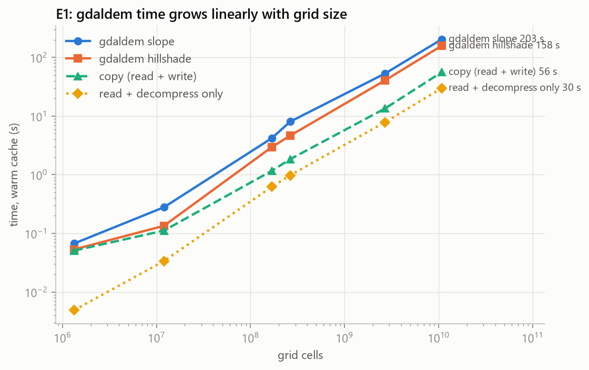
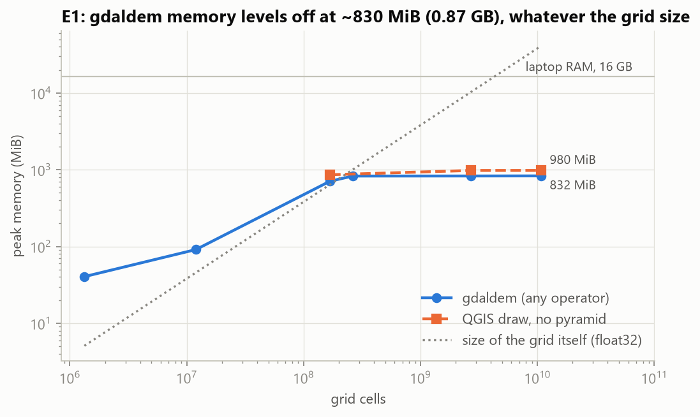
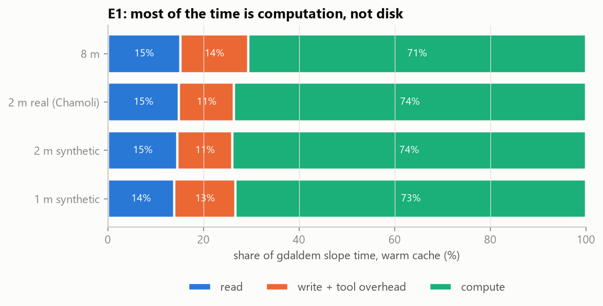
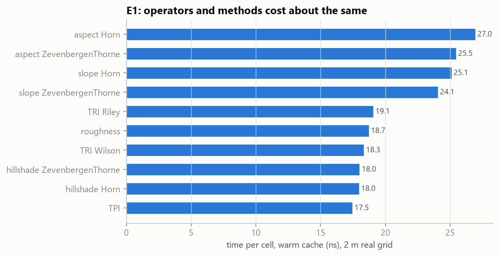
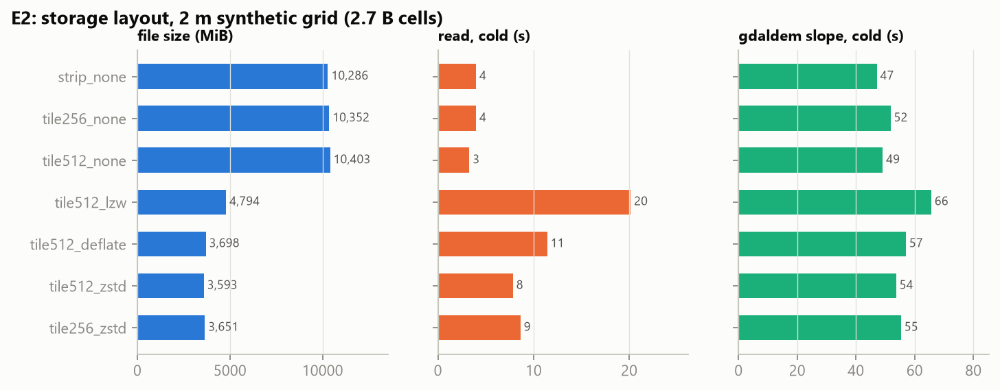
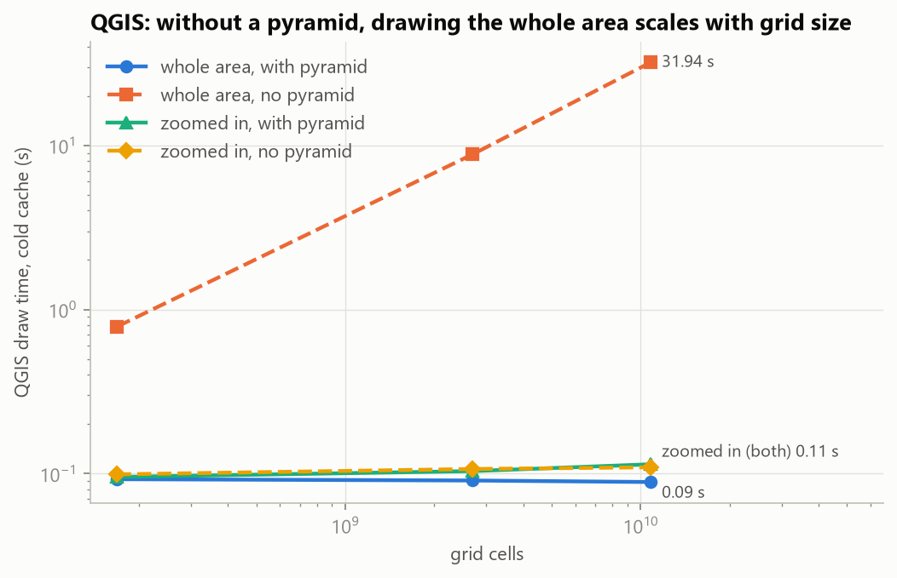

# Phase 2 results: baseline benchmarks (E1, E2, QGIS display)

All numbers below come from `results/runs.csv` (832 runs, 0 failures) and are reproduced by
`python -m bench.analysis.phase2_report`, which writes `results/phase2_tables.md` and the charts in `results/plots/`.
Values are medians over the measured repeats; the spread of every configuration (median and IQR) is in
`results/run_stats.md` (median IQR: E1 1.4%, E2 1.3%, QGIS 1.6% of the median). On the synthetic 2 m and 1 m grids
the "warm" values, and all E2 write (create) times, are single runs (plan §6.2). Method: `docs/PROJECT_PLAN.md` §6.
Sizes: MB = 10^6 bytes, GB = 10^9 bytes (the harness records MiB; converted here).

**Machine:** Intel Core Ultra 9 185H (6 performance + 8 efficiency + 2 low-power cores), 16 GB RAM (15.5 GiB usable),
NVMe SSD (cold reads measured at 2.7–3.3 GB/s in E2), RTX 4060 8 GiB (not used yet), Windows 11, GDAL 3.13.3,
QGIS 3.44.14.
**Data:** one study area (HMA tile-571, Uttarakhand / Nanda Devi) at real 90 / 30 / 8 m, real 2 m for the Chamoli
sub-area, and synthetic 2 m / 1 m grids (cubic upsamples, timing only) to go past the RAM size.

## Key findings

1. **gdaldem never runs out of memory on this laptop.** It processes the 1 m grid (10.8 billion cells, 43 GB as
   float32, 2.6× the RAM) with a peak of **0.87 GB**. It does not break; it only gets slower, linearly with size:
   about **19–25 ns per cell**, so **3.5 minutes** for slope over the whole 1 m tile.
2. **The bottleneck is single-threaded computation, not the disk or memory.** gdaldem uses 0.99 of 22 CPU threads.
   About **73%** of its time is computation, 14% reading/decompressing and 13% writing. Cold vs warm file cache
   changes the time by 2% or less.
3. **For display, the bottleneck is reading full-resolution data.** Without a pyramid, drawing the whole area in QGIS
   takes 0.8 s (8 m), 8.8 s (2 m) and **32 s (1 m)** per redraw. With the pyramid it takes **0.09 s at every size**,
   360× faster at 1 m, using 0.21 GB instead of 1.03 GB.
4. **Storage layout changes gdaldem time by up to ~40%**, but computation still dominates. Tiled ZSTD is the best
   compressed layout (2.9× smaller than uncompressed, decodes 2.6× faster than LZW); LZW, a common default, is the
   slowest layout and the largest of the compressed ones. Uncompressed is fastest for one full pass but takes 2.9× the disk space.
5. **Operators and methods cost about the same** (17.5–27 ns per cell); Horn vs Zevenbergen–Thorne differ by at
   most 6%. The choice of formula is not where speed comes from.

## E1: gdaldem baseline across grid sizes

| Grid | Cells | slope cold | slope warm | hillshade warm | ns / cell (slope) | Peak memory | CPU threads used |
|---|---|---|---|---|---|---|---|
| 90 m | 1.3 M | 0.08 s | 0.07 s | 0.06 s | (start-up dominated) | 42 MB | 0.88 |
| 30 m | 12 M | 0.29 s | 0.28 s | 0.13 s | 23.1 | 96 MB | 0.97 |
| 8 m | 169 M | 4.10 s | 4.02 s | 2.96 s | 23.8 | 745 MB | 0.98 |
| 2 m real (Chamoli) | 264 M | 6.67 s | 6.63 s | 4.74 s | 25.1 | 868 MB | 0.99 |
| 2 m synthetic | 2.7 B | 54.2 s | 53.7 s | 41.0 s | 19.9 | 870 MB | 0.99 |
| 1 m synthetic | 10.8 B | 208.3 s | 208.4 s | 158.9 s | 19.3 | 872 MB | 0.99 |

- **Linear scaling.** Time per cell settles at ~19–25 ns once start-up stops mattering (above ~10 M cells); it is
  slightly lower on the big synthetic grids (19–20 ns) than on the real ones (24–25 ns).
- **Memory levels off** at ~0.87 GB, about GDAL's default block cache (5% of RAM) plus the program itself: gdaldem
  streams the grid in strips.

- **Cache state does not matter.** At 2 m synthetic and 1 m even "warm" runs read 3.8 GB and 14.2 GB from disk, and
  they take the same time as cold runs. At 1 m the file does not fit in the file cache. At 2 m it would (the QGIS
  test reads it warm almost entirely from cache), but the ~11 GB that gdaldem writes pushes the input out. Either
  way, on this SSD reading is simply not the slow part.

### Where the time goes

Stage split from two reference runs per grid: a pure read + decompress of every block, and a `gdal_translate` copy
(same read + same-size write as gdaldem). Write ≈ copy − read; compute ≈ gdaldem − copy.

| Grid | read + decompress | write + tool overhead | compute |
|---|---|---|---|
| 8 m | 15% (0.61 s) | 14% (0.57 s) | 71% (2.83 s) |
| 2 m real | 15% (0.99 s) | 11% (0.76 s) | 74% (4.88 s) |
| 2 m synthetic | 15% (7.9 s) | 11% (6.2 s) | 74% (39.7 s) |
| 1 m synthetic | 14% (29.0 s) | 13% (26.8 s) | 73% (152.6 s) |

### Operators and methods (2 m real grid, warm)

TPI 17.5 · hillshade 18.0 (Horn and ZT) · TRI Wilson 18.3 · roughness 18.7 · TRI Riley 19.1 · slope ZT 24.1 ·
slope Horn 25.1 · aspect ZT 25.5 · aspect Horn 27.0 ns per cell. The 8 m grid gives the same order (16.9–25.8).
Horn vs ZT: slope 4%, aspect 6%, hillshade 0%.

### Effect of pinning to performance cores (slope Horn, cold)

| Grid | Unpinned (first pass) | Pinned |
|---|---|---|
| 2 m synthetic | median 71.8 s, runs 55.8–108.9 s (74% spread) | median 54.2 s, 53.7–55.2 s (2.8%) |
| 1 m synthetic | 210.8 s | 208.3 s |

This CPU runs gdaldem 1.7× slower on its efficiency cores and up to 2.7× slower on its low-power cores, and Windows
can move a background process onto them mid-run. All final numbers are pinned to the performance cores, i.e. each
baseline tool measured at its best.

## E2: storage layout (2 m synthetic grid, 2.7 B cells)

| Layout | File size | Write (create) | Read, cold | gdaldem slope, cold |
|---|---|---|---|---|
| strips, uncompressed (GDAL default) | 10.8 GB | 13.9 s | 4.0 s | **47.1 s** |
| tiles 256, uncompressed | 10.9 GB | 13.5 s | 4.0 s | 51.8 s |
| tiles 512, uncompressed | 10.9 GB | 13.3 s | 3.3 s | 49.1 s |
| tiles 512, LZW | 5.0 GB | 88.9 s | 20.1 s | 65.7 s |
| tiles 512, DEFLATE | 3.9 GB | 113.4 s | 11.4 s | 57.0 s |
| **tiles 512, ZSTD** (our COGs) | **3.8 GB** | 123.9 s | **7.8 s** | 53.7 s |
| tiles 256, ZSTD | 3.8 GB | 121.0 s | 8.6 s | 55.3 s |

The real 8 m grid shows the same pattern: slope 3.42 s (strips, uncompressed), 3.94 s (ZSTD), 4.78 s (LZW); files
674 MB vs 324 MB vs 423 MB.

- **Compression costs CPU inside the single gdaldem thread.** LZW makes slope 39% slower than uncompressed strips;
  ZSTD only 14%.
- **ZSTD is the best compressed choice**: the smallest file and the fastest decode. Writing compressed files is 6–9×
  slower than uncompressed (ZSTD 9×, DEFLATE 8×, LZW 6–7× at 2 m), but that is paid once, when the pyramid is built.
- **512-pixel tiles are slightly better than 256** for full passes. Strips are fine for gdaldem's line-by-line access,
  but tiles are needed for reading small windows (the on-demand viewer).

## QGIS: opening and drawing one 1920 × 1080 view

| Grid | Whole area, with pyramid | Whole area, **no pyramid** | Zoomed in (1920 m × 1080 m), either | Peak memory (whole area: pyramid / none) |
|---|---|---|---|---|
| 8 m | 0.09 s | 0.79 s | 0.10 s | 209 MB / 903 MB |
| 2 m synthetic | 0.09 s | 8.82 s | 0.10–0.11 s | 210 MB / 1027 MB |
| 1 m synthetic | 0.09 s | **31.9 s** | 0.11 s | 210 MB / 1028 MB |

Opening a layer takes 0.02–0.03 s in every case (GDAL statistics caches disabled, so each open starts clean).
**Only the zoomed-out view needs the pyramid**: a zoomed-in view reads just its window, so it stays at ~0.1 s even
without one. Without a pyramid, every zoomed-out redraw of the 1 m grid reads the whole full-resolution level of
the file (about 12.7 GB from disk; the file is 17.9 GB with its pyramid), close to the 29 s a pure read + decompress
of it takes.

## What this answers (research gap G1)

On a 16 GB laptop with an NVMe SSD, the standard tools **do not stop working** at 1 m. They stop being *practical*:
- **processing** is limited by **single-threaded computation**: 3.5 min for one slope pass over a 1 m tile, using 1
  of 22 threads, with disk and memory far from their limits;
- **display** is limited by **reading full-resolution data**: without a pyramid, a whole-area redraw grows with the
  grid (32 s at 1 m); with one it stays at 0.09 s.

## What it means for Phases 3–5

- **Phase 3 (our engine):** the biggest gain is parallel computation across the 22 threads. Decompression must be
  parallel too, since read + decompress alone is 29 s single-threaded at 1 m, while the SSD could deliver the ~12.7 GB
  of compressed full-resolution data in about 4–5 s. Computing slope, aspect and hillshade **in one pass** avoids re-reading and re-writing the
  grid (~27% of each gdaldem run). For the GPU (E4), copying data to it is cheap compared with this; the open question
  is whether decompression on the CPU can keep up with it.
- **Phases 4–5 (pyramid, on-demand viewer):** the QGIS results confirm the meeting's direction. With a pyramid, display
  cost no longer depends on grid size. On-demand terrain computation is cheap: at ~25 ns per cell, slope for one
  256 × 256 tile is ~1.6 ms on one thread, so the real cost is reading the right window at the right pyramid level.

## Is the baseline configured fairly?

GDAL can decompress tiles in parallel (`GDAL_NUM_THREADS`, GDAL ≥ 3.6) and its block cache defaults to 5% of RAM
(`GDAL_CACHEMAX`). We checked whether tuning these makes gdaldem faster (warm cache, slope Horn, medians of 3):

| Grid | Default | `GDAL_NUM_THREADS=ALL_CPUS` | + `GDAL_CACHEMAX=4GB` |
|---|---|---|---|
| 8 m | 4.10 s (0.99 cores) | 4.20 s (1.99 cores) | 4.46 s |
| 2 m real | 6.85 s (0.97 cores) | 7.15 s (2.24 cores) | 7.23 s |

Parallel decoding makes gdaldem use ~2 cores but run 2–4% *slower*: decompression is only ~15% of its time and the
thread overhead outweighs the gain; a larger cache does not help a single streaming pass. The default configuration
is therefore also gdaldem's fastest, and all baseline numbers use it. The ~0.87 GB memory plateau matches the
default `GDAL_CACHEMAX` (5% of the 15.5 GiB RAM, about 0.83 GB) plus the program itself. These tuning numbers come
from a separate one-off session (printed, not stored in `runs.csv`), which is why its default times differ slightly
from the E1 medians. (Check script: `old files/scripts_one_off_checks/gdal_numthreads_check.py`.)

## Data quality and caveats

- **Repeatability:** the median IQR per configuration is 1.4% (E1) and 1.3% (E2) of the median, and no E1
  configuration exceeds about 9% (`results/run_stats.md`). As full range (max − min), the per-grid median is 0.7–3.3% for
  grids ≥ 169 M cells. Remaining outliers are single slow runs: one 8 m aspect run with background disk activity, and
  one 8 m cold pure-read reference at 2.9 s against ~0.8 s (the stage split uses the warm references). Medians are
  used throughout.
- **90 m and 30 m runs** take 0.05–0.35 s (medians) and mostly measure program start-up; they are not used for per-cell speed.
- **Synthetic 2 m / 1 m grids** add cells but no real terrain detail; they are used only for timing, never accuracy.
- **Large-grid "warm" runs** still read most of the file from disk (at 1 m the file is bigger than the cache, at
  2 m gdaldem's own output pushes it out); they are reported as such.
- **Background interference** was found and removed before these final runs: efficiency-core scheduling (fixed by
  pinning) and Windows Defender scanning our 10–40 GB temporary outputs after each run (fixed by excluding only the two
  scratch folders). Earlier, disturbed attempts are kept as evidence in `results/` (`e1_first_pass_unpinned.csv`,
  `e1_chamoli_background_interference.csv`, `phase2_attempt2_defender_scanning.csv`).

## Files

| File | Contents |
|---|---|
| `results/runs.csv` | Every run: dataset, layout, operator, method, cache state, repeat, times, peak memory, CPU, bytes read/written |
| `results/phase2_tables.md` | All tables above, generated |
| `results/plots/*.png` | The six charts |
| `results/e2_files.csv` | File size of each E2 layout (the 2 m layout copies are on the external drive, `K:\spatial project\e2`) |
| `results/env/*.json` | Conditions of each sweep (power plan, Defender, core classes, pinned CPUs, free RAM) |
| `results/machine.json` | Hardware and library versions |
