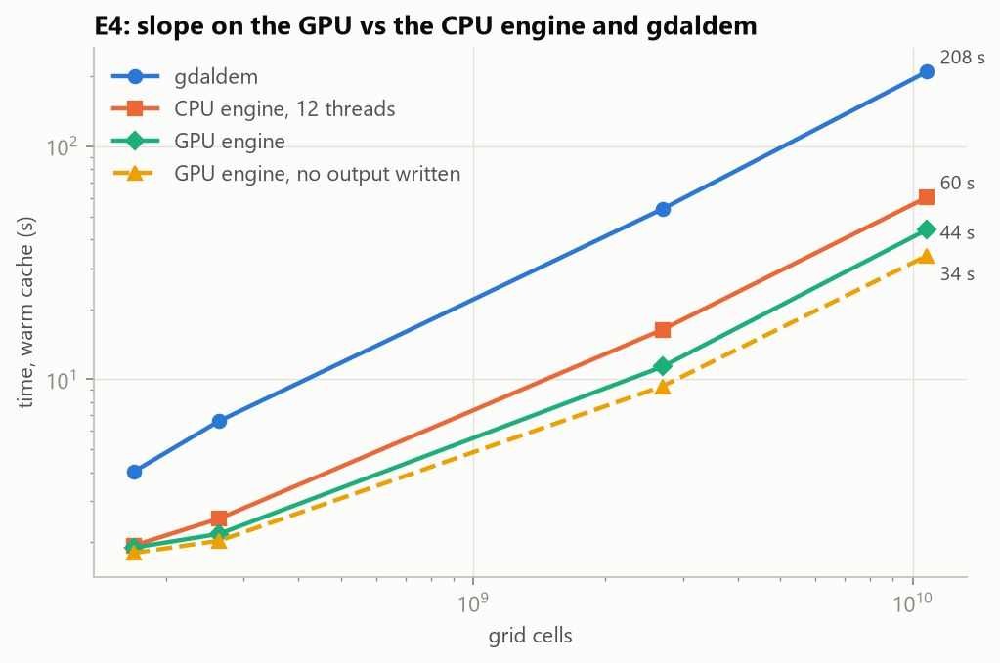
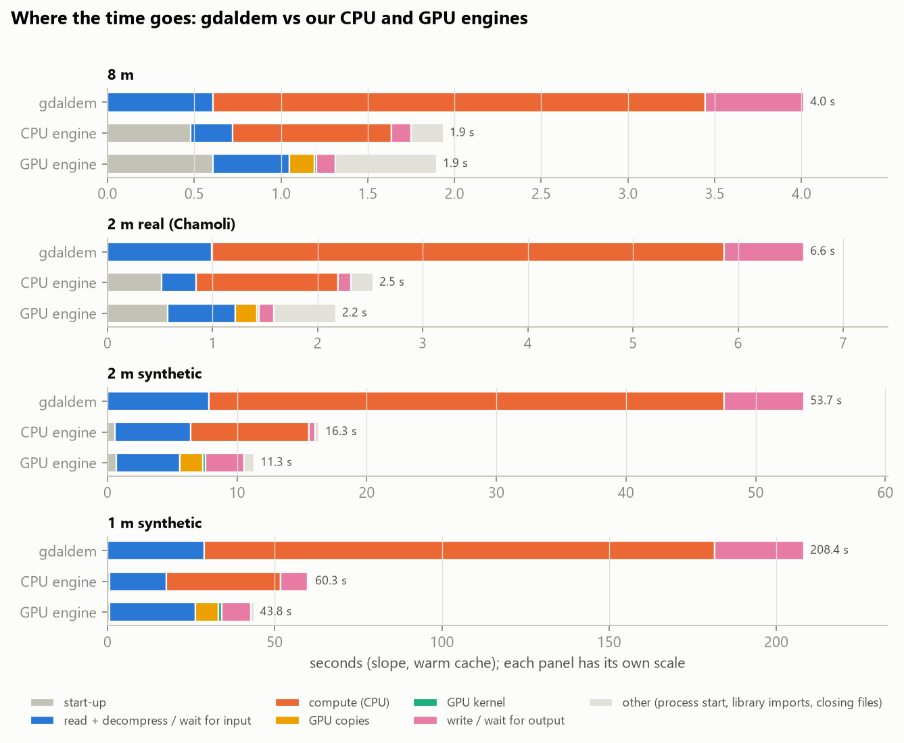
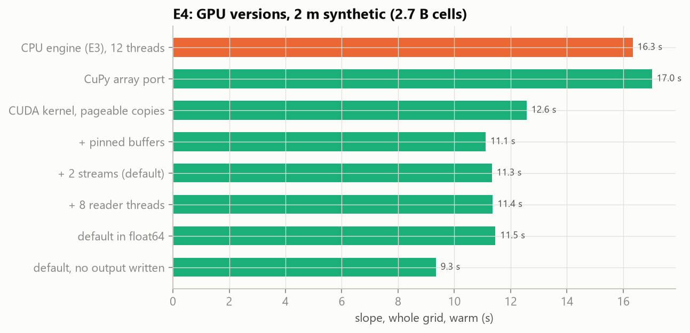
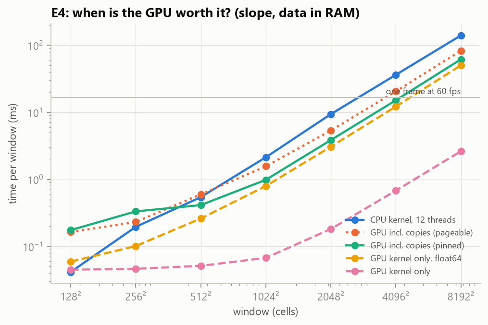

# Phase 3 results, GPU part: our engine on the GPU (E4)

All numbers come from the E4 rows of `results/runs.csv` and from `results/e4_crossover.csv`, and are reproduced by
`python -m bench.analysis.e4_report` (tables `results/e4_tables.md`, charts `results/plots/e4_*.png`). Values are
medians over the measured repeats, warm cache unless stated; the spread of every configuration (median and IQR) is
in `results/run_stats.md` (E4: median IQR 1.2% of the median, none above 4%). On the 2 m and 1 m synthetic grids a
"warm" value is often a single run (1 m always). CPU engine numbers are from E3 (`docs/PHASE3_RESULTS.md`) and gdaldem numbers
from E1 (`docs/PHASE2_RESULTS.md`): same machine, grids and harness. Sizes: MB = 10^6 bytes, GB = 10^9 bytes,
except GPU memory, given in MiB / GiB as the driver reports it.

**GPU:** NVIDIA RTX 4060 Laptop, 8 GiB, 24 SMs, PCIe 4.0 ×8, driver 610.60, CuPy 14.2 / CUDA 12.9.

**What was run:**
- **E4 sweep** (`bench/experiments/e4_gpu.py`, launcher `bench/run_e4.ps1`): 484 runs, no failures, on the same
  four grids as E3. It covers the optimisation steps below, every gdaldem operator configuration, three products
  in one pass, with and without writing, float32 vs float64, 4 vs 8 reader threads, and window sizes 1024–8192.
  Each run is a separate `python -m demlab.cli --impl cuda` process, pinned to the 12 performance-core threads
  (the CPU side only reads, decompresses and writes). Inside, the three GPU stages are timed with CUDA events:
  copy to the GPU, kernel, copy back.
- **Crossover test** (`bench/experiments/e4_crossover.py`): one process, one real elevation block (Chamoli 2 m,
  99% valid), windows from 128² to 8192² cells, data already in RAM, no disk. It compares the 12-thread CPU kernel
  with the GPU kernel alone and with the GPU including its copies (pinned and ordinary memory).

**The GPU engine** (`demlab/kernels/cuda_k.py`, `demlab/gpu.py`): our own CUDA kernels, the same 10 operator
configurations as the CPU engine, one GPU thread per cell, slope + aspect + hillshade fused in one kernel. It plugs
into the same read → compute → write pipeline as the CPU engine; only the compute stage changes. Each window is
copied into a pinned (page-locked) buffer, copied to the GPU, computed, and copied back. Windows alternate between
2 CUDA streams, so one window's copies overlap the next window's kernel. Arithmetic is float32: GDAL itself adds
the Horn neighbour values in float32, and laptop GPUs run float64 at 1/64 of the float32 rate.

## Key findings

1. **The GPU computes 50× faster than the 12-thread CPU kernel, but the whole run is only 1.0–1.4× faster.**
   Slope at 1 m: 43.8 s on the GPU vs 60.3 s for the CPU engine vs 208 s for gdaldem (4.75× faster than
   gdaldem). The GPU kernel needs 1.1 s for the whole 10.8-billion-cell grid, where the 12-thread CPU engine's kernel
   needed 34 s.
   The rest of the run is moving data.
2. **Copying is 95% of the GPU's own time.** For a 2048² window, the kernel takes 0.18 ms and kernel plus copies
   3.85 ms (data in RAM). Crossing PCIe, not computing, is the GPU's cost.
3. **The GPU only beats the CPU above a minimum size.** Including copies, it is faster than the CPU kernel from
   **512 × 512** cells for slope (1.3×) and from **256 × 256** for three products. Below that the CPU wins: a GPU
   round trip costs at least ~0.17 ms whatever the size. From 1024² up the GPU is 2.2–2.4× faster for slope and
   3.6–3.7× for three products.
4. **After the GPU, the bottleneck moves twice.** At 1 m the main thread spends 25.7 s waiting for input to be
   decompressed and 7.8 s on the GPU. With 8 reader threads instead of 4 the read wait falls to 3.2 s, but the
   writer then becomes the limit (writing 43 GB, wait 30.6 s), and the total only goes from 43.8 to 42.6 s.
   **Computation → reading → writing:** each fix exposes the next stage, and on this laptop the end of the chain is
   the disk write (about 1.1 GB/s from one writer thread).
5. **Three products gain the most.** Slope + aspect + hillshade in one pass: 81 s at 1 m vs 135 s for the CPU
   engine (1.7×); at 2 m real 3.1 s vs 18.5 s for three gdaldem runs (5.9×). The fused kernel does three times
   the arithmetic for almost the same copies in.
6. **How the GPU should be used matters more than the GPU.** On 2 m synthetic, the straightforward port (the NumPy
   code run through CuPy arrays) takes 17.0 s, *slower* than the CPU engine (16.3 s). Our own kernel brings it to
   12.6 s, and pinned buffers to 11.1 s. Each step roughly halves the GPU stage (14.5 → 7.6 → 3.7 → 2.0 s with 2
   streams), but the total stops improving once reading and writing dominate.
7. **float64 makes the kernel 8–24× slower but costs nothing in the total.** In the crossover test the float64
   slope kernel is 12–19× slower from 1024² up (at 2048²: 3.07 ms instead of 0.18 ms, almost as long as the copies),
   and the three-product kernel 16–24× slower (21–24× from 2048²). Inside whole runs it is 8–12× slower. Whole runs take the same time (11.5 vs 11.3 s) because the
   kernel is not the limit. float32 already matches gdaldem's Horn rounding, so float32 stays the default.
8. **The GPU was never stressed.** Over all 484 runs the GPU was at most 63 °C after a run (median 58 °C), our
   memory pool used at most 2.0 GiB of the card's 8 GiB, and no run failed. Before every run the harness waited until the GPU
   was below 75 °C (it never had to wait) and would have stopped the sweep at 85 °C. No clock, power-limit, fan or
   driver setting was changed.

## Slope: GPU vs CPU engine vs gdaldem

| Grid | Cells | gdaldem | CPU engine (12 threads) | GPU engine | GPU vs CPU engine | GPU vs gdaldem | GPU, no output | GPU cold |
|---|---|---|---|---|---|---|---|---|
| 8 m | 169 M | 4.02 s | 1.94 s | 1.90 s | 1.0× | 2.1× | 1.80 s | 2.68 s |
| 2 m real (Chamoli) | 264 M | 6.63 s | 2.53 s | 2.18 s | 1.2× | 3.0× | 2.03 s | 2.94 s |
| 2 m synthetic | 2.7 B | 53.7 s | 16.3 s | **11.3 s** | 1.4× | 4.7× | 9.3 s | 11.9 s |
| 1 m synthetic | 10.8 B | 208.4 s | 60.3 s | **43.8 s** | 1.4× | **4.75×** | 33.9 s | 43.6 s |

**The 8 GiB GPU memory limit (an E4 variable in the plan) is never reached**, because the engine sends the grid to
the GPU window by window: even with 8192² windows it uses at most 2.0 GiB. Sending a whole grid at once would need
4 bytes per cell for the input plus 4 per float32 output: about 1.4 GB for 8 m, 2.1 GB for 2 m real, but 22 GB for
2 m synthetic and 86 GB for 1 m, far beyond 8 GiB. As on the CPU (naive NumPy), only tiling scales.

Peak RAM stays flat at 1.6–1.7 GB, and GPU memory at 128 MiB (two 2048² windows in flight), whatever the grid
size. On the small grids about 0.6 s of every run is fixed start-up: Python 0.5 s, GPU initialisation 0.1 s.

## Where the GPU engine's time goes

The bottleneck moves, from gdaldem to our CPU engine to the GPU engine. gdaldem's time is mostly single-threaded
computation (orange). The CPU engine shrinks that, and at large sizes waiting for input grows to about half of its compute time. The GPU
engine almost removes computation (green), leaving reading, copying (yellow) and writing. For gdaldem the stages come
from the Phase 2 stage split and run one after the other. For our engines they show how the main thread spends the
run: the writer thread works in parallel, so only the time spent *waiting* for it appears (table:
`results/e4_tables.md`, "Stage split").

Slope, warm. The three GPU stages run in parallel with each other (2 streams), so their sum can exceed the GPU
part.

| Grid | Total | Start-up + GPU init | Wait for read | GPU part | Copy in / kernel / copy out | Wait for writer | Writer busy | Written |
|---|---|---|---|---|---|---|---|---|
| 8 m | 1.90 s | 0.61 s | 0.44 s | 0.16 s | 0.06 / 0.013 / 0.07 s | 0.11 s | 0.57 s | 0.71 GB |
| 2 m real | 2.18 s | 0.57 s | 0.64 s | 0.23 s | 0.10 / 0.017 / 0.11 s | 0.14 s | 0.86 s | 1.10 GB |
| 2 m synthetic | 11.3 s | 0.66 s | 4.9 s | 2.0 s | 1.04 / 0.23 / 0.95 s | 3.0 s | 9.5 s | 10.9 GB |
| 1 m synthetic | 43.8 s | 0.66 s | **25.7 s** | 7.8 s | 4.5 / **1.1** / 4.1 s | 8.8 s | **39.2 s** | 43.4 GB |
| 1 m, 8 readers | 42.6 s | | 3.2 s | 7.2 s | 4.7 / 1.1 / 4.4 s | **30.6 s** | | 43.4 GB |
| 1 m, no output | 33.9 s | 0.64 s | 25.7 s | 6.5 s | 4.2 / 1.0 / 3.8 s | 0 | 0 | 0 |

Compared with the CPU engine at 1 m: computation drops from 34 s (12 threads; 33 s with 22) to 1.1 s of kernel
time. The writer thread also gets faster (39 s instead of 65 s with the 22-thread CPU engine, for the same 43 GB),
because the CPU cores are no longer busy computing.

## GPU versions: the optimisation steps

Slope, warm. "GPU part" is the time the main thread spends handing windows to the GPU and getting results back.

| Version | 8 m | 2 m real | 2 m synthetic | 2 m synthetic: GPU part | 2 m synthetic: wait for read |
|---|---|---|---|---|---|
| CPU engine (E3), 12 threads | 1.94 s | 2.53 s | 16.3 s | (CPU compute 9.1 s) | 5.8 s |
| CuPy array port (NumPy code on the GPU, float64) | 2.24 s | 2.64 s | 17.0 s | 14.5 s | 1.3 s |
| Our CUDA kernel, ordinary (pageable) copies, 1 stream | 1.93 s | 2.26 s | 12.6 s | 7.6 s | 0.1 s |
| + pinned buffers | 1.90 s | 2.19 s | **11.1 s** | 3.7 s | 2.3 s |
| + 2 streams (**default**) | 1.90 s | 2.18 s | 11.3 s | **2.0 s** | 4.9 s |
| + 8 reader threads | 1.97 s | 2.22 s | 11.4 s | 2.0 s | 0.7 s |
| default in float64 | 1.94 s | 2.17 s | 11.5 s | 2.0 s | 2.8 s |
| default, no output written | 1.80 s | 2.03 s | 9.3 s | 1.7 s | 6.3 s |

- **The straightforward port is no faster than the CPU.** Array code on the GPU creates a full temporary array for
  every intermediate result (in float64), so it spends its time on memory traffic and float64 arithmetic.
- **Our kernel** does everything for a cell in one pass, in float32: the GPU part halves (14.5 → 7.6 s).
- **Pinned buffers** let the copies run at full PCIe speed (2 m synthetic: about 10–11 GB/s in both directions,
  instead of 5.6 GB/s to the GPU and 2.5 GB/s back from ordinary memory): halved again.
- **Two streams** overlap copies and kernels: halved again (3.7 → 2.0 s). But the total does not move (11.1 vs
  11.3 s), because the main thread now just waits longer for input. From here on, faster GPU code cannot help.

## When is the GPU worth it? (crossover)

One window, data already in RAM, no disk (milliseconds per window, median):

| Window | CPU kernel, 12 threads | GPU incl. copies (pinned) | GPU incl. copies (pageable) | GPU kernel only | GPU kernel, float64 | GPU vs CPU | Copies' share of GPU time |
|---|---|---|---|---|---|---|---|
| 128² | **0.04** | 0.17 | 0.16 | 0.04 | 0.06 | 0.24× | 74% |
| 256² | **0.20** | 0.33 | 0.23 | 0.05 | 0.10 | 0.59× | 86% |
| 512² | 0.54 | **0.41** | 0.60 | 0.05 | 0.26 | 1.3× | 88% |
| 1024² | 2.13 | **0.98** | 1.56 | 0.07 | 0.79 | 2.2× | 93% |
| 2048² | 9.38 | **3.85** | 5.34 | 0.18 | 3.07 | 2.4× | 95% |
| 4096² | 36.3 | **15.1** | 20.6 | 0.68 | 12.2 | 2.4× | 96% |
| 8192² | 140.1 | **61.7** | 82.8 | 2.62 | 50.2 | 2.3× | 96% |

Slope + aspect + hillshade: the GPU (pinned) is ahead from 256² (1.15×) and 3.6–3.7× faster from 1024² up.

- **Below ~512² the CPU wins.** A GPU round trip has a fixed cost (kernel launch, two copies, synchronisation) of
  about 0.17 ms, which a 12-thread CPU kernel beats on small windows.
- **The GPU kernel alone is ~50× faster** (0.04 vs 2.1 ns per cell), but the copies take 93–96% of the GPU's time.
  Over PCIe 4.0 ×8 a cell costs about 0.9 ns to move in and out, against 0.04 ns to compute.
- **Pinned buffers pay off from 512²** (1.3–1.6× faster round trips). On tiny windows, copying into the pinned buffer
  first costs more than it saves.
- **For on-demand display (Phases 4–5)** the kernel is not a problem on either device. A 512² display tile with
  three products takes 0.48 ms on the GPU and 1.3 ms on the CPU, both far below the 16.7 ms of one frame at 60 fps.
  As in E3, reading and decoding the elevation tiles will be what limits interactivity.

## Every gdaldem operator, and three products in one pass

| Operator | 8 m: gdaldem / CPU engine / GPU | 2 m real: gdaldem / CPU engine / GPU |
|---|---|---|
| slope Horn | 4.02 / 2.28 / 1.90 s | 6.63 / 2.72 / 2.18 s |
| slope Zevenbergen–Thorne | 3.86 / 2.22 / 1.85 s | 6.35 / 2.78 / 2.21 s |
| aspect Horn | 4.34 / 2.19 / 1.87 s | 7.12 / 2.78 / 2.18 s |
| aspect Zevenbergen–Thorne | 4.22 / 2.32 / 1.87 s | 6.72 / 2.82 / 2.21 s |
| hillshade Horn | 2.96 / 2.08 / 1.78 s | 4.74 / 2.42 / 2.07 s |
| hillshade Zevenbergen–Thorne | 2.92 / 1.99 / 1.78 s | 4.76 / 2.43 / 2.02 s |
| TRI Riley | 3.13 / 2.17 / 1.86 s | 5.04 / 2.72 / 2.20 s |
| TRI Wilson | 3.01 / 2.21 / 1.87 s | 4.84 / 2.75 / 2.21 s |
| TPI | 2.85 / 2.20 / 1.87 s | 4.61 / 2.70 / 2.18 s |
| roughness | 3.02 / 2.20 / 1.88 s | 4.94 / 2.72 / 2.21 s |

CPU engine = all 22 threads, as in E3's operator table. On these small grids the GPU is 1.1–1.3× faster than the
CPU engine and 1.5–3.3× faster than gdaldem, for every operator. As on the CPU, the time is the same for every
operator: start-up and I/O, not arithmetic.

| Slope + aspect + hillshade | gdaldem, 3 runs | CPU engine, fused | GPU engine, fused | GPU writer busy | Written |
|---|---|---|---|---|---|
| 8 m | 11.3 s | 3.33 s | **2.56 s** | 1.2 s | 1.6 GB |
| 2 m real | 18.5 s | 4.44 s | **3.13 s** | 1.8 s | 2.5 GB |
| 2 m synthetic | – | 34.4 s | **21.0 s** | 18.8 s | 24.4 GB |
| 1 m synthetic | – | 134.8 s | **81.4 s** | 76.5 s | 96.8 GB |

At 2 m synthetic and 1 m the fused GPU run is write-bound: the writer is busy for 90–94% of the run.

## Window size on the GPU

| Window | 8 m | 2 m real | 2 m synthetic | Peak RAM (2 m synthetic) | GPU memory (2 m synthetic) |
|---|---|---|---|---|---|
| 1024 | 1.98 s | 2.40 s | 13.8 s | 1.4 GB | 32 MiB |
| **2048** (default) | **1.90 s** | **2.18 s** | 11.3 s | 1.7 GB | 128 MiB |
| 4096 | 2.09 s | 2.34 s | **11.1 s** | 3.0 GB | 512 MiB |
| 8192 | 2.57 s | 2.98 s | 13.0 s | 8.0 GB | 2.0 GiB |

The same picture as on the CPU, for the same reason: small windows decompress the neighbouring tiles again for
the halo, and large windows hold too much in flight. 2048 stays the default (4096 is 2% faster on one grid, at
almost twice the memory).

## Correctness

- **Unit tests** (`python -m pytest tests/`): the float32 GPU kernel against gdaldem on the two 1024²
  crops for all 10 configurations, held to the tight tolerances of the exact-parity tests. The float64 GPU kernel
  is compared against the CPU engine, and the GPU pipeline with every copy and overlap mode against the whole-grid
  result, for windows that are not aligned to the tiles.
- **Full grids** (`python -m tests.check_full_grid`, `results/e3_fullgrid_check.md`): the GPU engine against
  gdaldem on every cell of the whole 90 m, 30 m, 8 m and 2 m real grids (1.3 M, 12 M, 134 M and 247 M valid
  cells), all 10 configurations. **Identical nodata masks and no cell beyond tolerance in any configuration on
  any grid.** On 8 m and 2 m: Horn slope and aspect are within 0.000008° and 0.00003°, TRI / TPI within 0.0013 m,
  roughness and TRI Wilson identical. Horn hillshade differs by 1 grey level on 0.15% (8 m) and 0.43% (2 m real) of
  cells (float32 rounding at the .5 boundary); Zevenbergen–Thorne hillshade on about 0.001%.
- For **Horn slope and aspect** the GPU engine matches gdaldem *more* closely than the float64 CPU engine, because
  the float32 kernel adds the Horn neighbours exactly as gdaldem does. The CPU engine had 31 k / 188 k near-flat
  cells with Horn aspect more than 0.1° away (`docs/PHASE3_RESULTS.md`). For Horn hillshade and TRI Riley it is
  the other way round, by tiny margins: one grey level on 0.15–0.43% of cells, and 0.0001 m.

## What it means

- **For G1 (where the bottleneck is):** the stage-by-stage numbers answer the question from the professor
  meeting. On this laptop, gdaldem is limited by single-threaded computation. Our CPU engine removes that and
  becomes limited by decompressing the input and writing the output. The GPU removes computation almost entirely
  (1.1 s for 10.8 billion cells), and what is left is reading, writing and copying over PCIe. A GPU is worth
  adding only where computation is still a large share: several products at once, heavier operators, or results
  that are not written to disk.
- **For batch processing of whole grids:** use the GPU when available, fused products, 2048 windows, float32
  (1.4–1.7× over the CPU engine on the 2 m and 1 m synthetic grids, 1.2–1.4× on the 2 m real grid). Beyond that, the next gains have to come from the I/O: not writing
  full-resolution products at all, writing them compressed with spare CPU, or writing to a faster disk.
- **For on-demand display (Phases 4–5):** computation is cheap on both devices. A 512² tile takes 0.5 ms (slope) or 1.3 ms
  (three products) on the 12-thread CPU, and 0.4–0.5 ms on the GPU including copies.
  The tile server can use the CPU for small tiles and the GPU for large views, but tile latency will be set by
  reading and decoding the elevation data, which is what the pyramid and a decoded-tile cache address.
