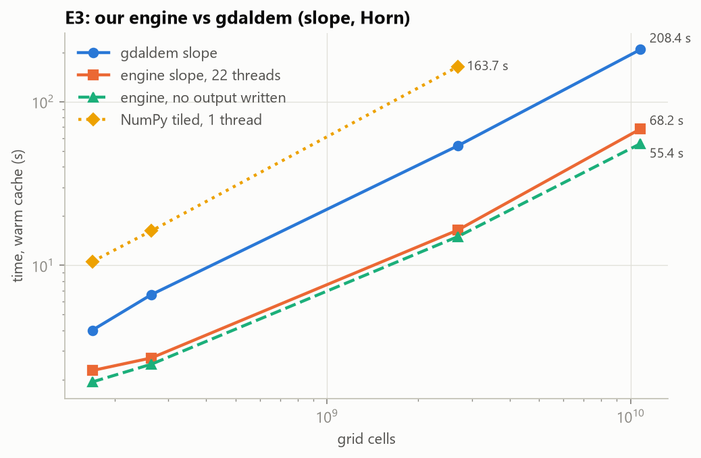
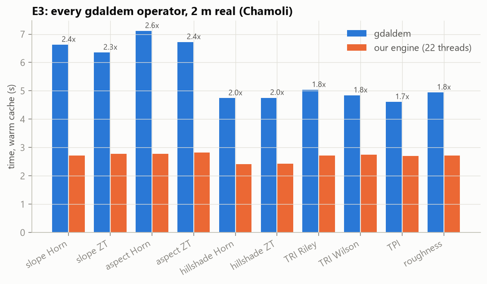
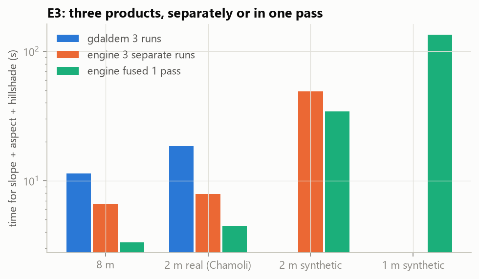
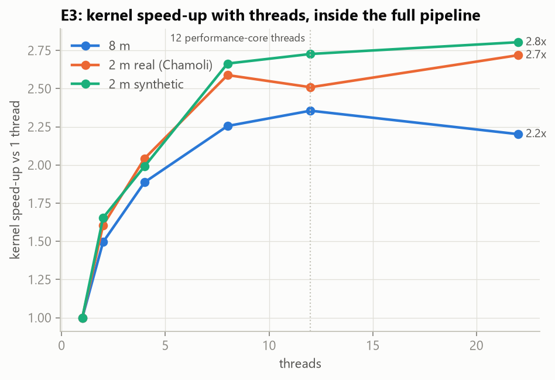
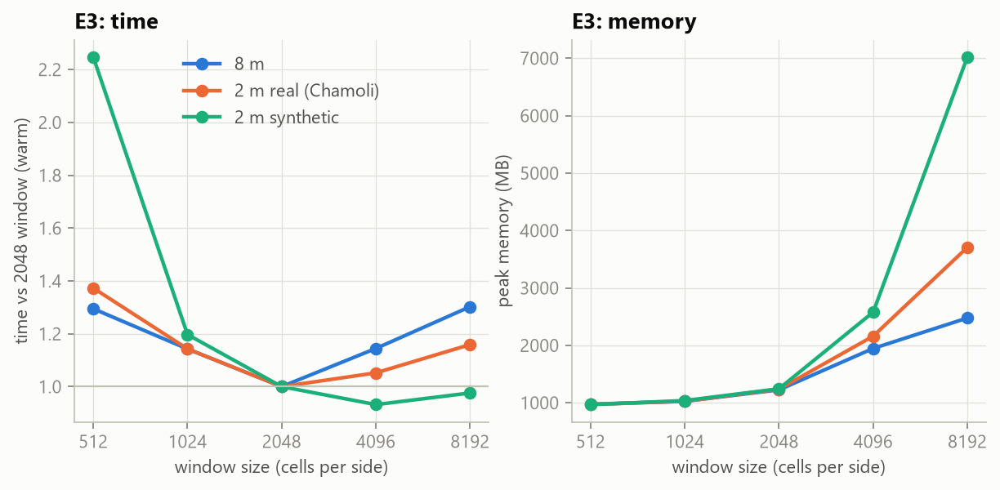
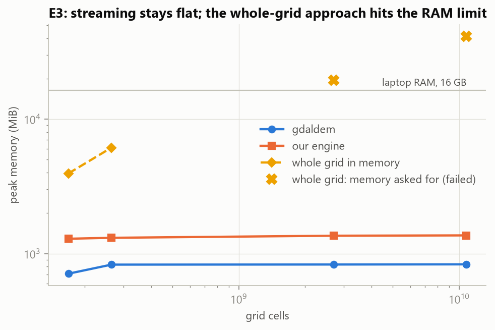

# Phase 3 results, CPU part: our engine vs gdaldem (E3)

All numbers come from the E3 rows of `results/runs.csv` and are reproduced by
`python -m bench.analysis.phase3_report`, which writes `results/phase3_tables.md` and the charts
`results/plots/e3_*.png`. Values are medians over the measured repeats. The gdaldem numbers are the E1 runs from
Phase 2 (`docs/PHASE2_RESULTS.md`): same machine, same grids, same harness.

**What was run:** 501 E3 runs on four grids (8 m and 2 m real, 2 m and 1 m synthetic): 24 variants,
including all 10 gdaldem operator configurations of E1. Repeats are 5 cold + 5 warm on the real grids and fewer on
the big synthetic ones. Two runs failed, both expected: the whole-grid NumPy version running out of memory.
Every run is a separate `python -m demlab.cli` process, measured exactly like gdaldem (wall time including Python
start-up, peak memory, CPU, bytes). Cold runs flush the file cache first. Output is written to the internal SSD
and deleted after each run.

**The engine** (`demlab/engine.py`, `demlab/kernels/numba_k.py`): the grid is processed in 2048 × 2048 windows
with a 1-cell halo, as a three-stage pipeline: 4 reader threads (each with its own GDAL handle, at most 6 windows in
flight), a compiled parallel Numba kernel, and one writer thread (GDAL's multi-threading docs warn against writing
from several threads). Slope, aspect and hillshade can be computed in one fused pass. Output is a tiled,
uncompressed GeoTIFF. The values match gdaldem, on 1024² crops (60 tests in `tests/`) and on the full grids (see
"Correctness on the full grids" below).

**Variants:** `engine_all` = all 22 logical CPUs, 22 threads; `engine_perf` = the 12 performance-core threads
gdaldem was pinned to, 12 threads; `numpy_tiled` = same pipeline with the single-threaded NumPy reference kernel;
`naive` = the whole grid read into memory and processed with NumPy, no tiling.

## Key findings

1. **The engine is 2.1–3.5× faster than gdaldem for slope, and the gain grows with size.** On the same 12 cores
   gdaldem used: 8 m 1.9 s vs 4.0 s, 2 m real 2.5 s vs 6.6 s, 2 m synthetic 16.3 s vs 53.7 s, **1 m synthetic
   60 s vs 208 s**. At 1 m that is about **5.6 ns per cell against gdaldem's 19 ns**. Small grids gain less because
   about 1 s of every run is fixed cost (Python start-up 0.6 s, loading the compiled kernel 0.45 s).
2. **Memory stays flat at about 1.3 GB for every size**, including the 1 m grid (10.8 billion cells, 43 GB as
   float32). gdaldem stays at 0.83 GB. The whole-grid NumPy version needs about 23 bytes per cell: 3.9 GB at 8 m,
   6.1 GB at 2 m real, and it **fails at 2 m synthetic** (needed about 20 GB) and **at 1 m** (its first
   allocation, 40.2 GiB = 43 GB for the input alone, was refused). Out-of-core tiling is required past roughly 0.5–0.7 billion cells on this laptop.
3. **Every gdaldem operator is faster in our engine:** all 10 configurations of E1 (Horn and Zevenbergen–Thorne
   slope / aspect / hillshade, TRI Riley and Wilson, TPI, roughness) run 1.3–2.0× faster at 8 m and 1.7–2.6×
   faster at 2 m real. On these small grids the engine's time is the same for every operator (fixed cost + I/O).
4. **Three products in one pass cost little more than one.** Slope + aspect + hillshade: 3.3 s vs 11.3 s for three
   gdaldem runs at 8 m (3.4×) and 4.4 s vs 18.5 s at 2 m real (4.2×). At 1 m the fused pass takes 135 s, while
   gdaldem needs 367 s for only slope + hillshade.
5. **With computation parallel, the bottleneck has moved to moving data.** At 1 m (slope, 22 threads, 67.7 s) the
   kernel needs 31 s; the writer thread is busy for 65 s writing 41 GB (about 0.64 GB/s), so the run is
   **write-bound**. Without writing it is **read-bound**: 22 s of waiting for windows to be decompressed, partly
   because the 1-cell halo makes neighbouring compressed tiles get decoded again (2.25× the tiles at the 2048 window).
   gdaldem was 73% computation; our engine is mostly I/O.
6. **A 2048 × 2048 window is the best size.** 512 is up to 2.2× slower (halo re-decoding), and 8192 needs 7 GB
   for no gain.
7. **More threads stop helping early.** Inside the pipeline the kernel speeds up only 2.2–2.8× from 1 to 22
   threads. On its own, in memory, the same kernel scales 4.7× at 12 threads and 5.7× at 16. In the pipeline it
   shares the cores with decompression and writing. The 8 efficiency and 2 low-power cores make it slower, not
   faster: **12 performance-core threads beat all 22** (1 m: 60 s vs 68 s).
8. **Cold vs warm file cache changes almost nothing** (1 m: 67 s cold, 68 s warm). gdaldem's E1 numbers showed the
   same thing. Reading is limited by decompression, not by the disk.

## Slope: engine vs gdaldem

| Grid | Cells | gdaldem warm | Engine, 12 P-threads (same cores) | Speed-up | Engine, all 22 threads | Engine cold (22) | Engine peak memory | CPU threads used |
|---|---|---|---|---|---|---|---|---|
| 8 m | 169 M | 4.02 s | 1.94 s | 2.1× | 2.28 s | 2.68 s | 1.29 GB | 6.8 |
| 2 m real (Chamoli) | 264 M | 6.63 s | 2.53 s | 2.6× | 2.72 s | 2.84 s | 1.31 GB | 9.5 |
| 2 m synthetic | 2.7 B | 53.7 s | 16.3 s | 3.3× | 16.4 s | 16.9 s | 1.36 GB | 15.4 |
| 1 m synthetic | 10.8 B | 208.4 s | **60.3 s** | **3.5×** | 68.2 s | 67.2 s | 1.37 GB | 16.6 |

Single-threaded NumPy reference: the same tiled pipeline with the single-threaded NumPy kernel takes 10.5 s (8 m) and
164 s (2 m synthetic), 2.6–3× *slower* than gdaldem's C code. The speed-up comes from the compiled, parallel kernel,
not from tiling alone.

## Where the engine's time goes

Engine slope, all 22 threads, warm. "Wait for read" and "wait for writer" are the time the compute thread sat idle.
The writer thread works in parallel; "writer busy" is its own working time.

| Grid | Total | Python start-up | Wait for read | Compute | Wait for writer | Writer busy | Written |
|---|---|---|---|---|---|---|---|
| 8 m | 2.48 s | 0.61 s | 0.26 s | 1.06 s | 0.22 s | 0.97 s | 0.68 GB |
| 2 m real | 2.78 s | 0.58 s | 0.37 s | 1.31 s | 0.30 s | 1.42 s | 1.05 GB |
| 2 m synthetic | 16.9 s | 0.62 s | 2.5 s | 8.6 s | 4.8 s | 15.0 s | 10.4 GB |
| 1 m synthetic | 67.7 s | 0.74 s | 9.5 s | 31.1 s | 26.7 s | **64.6 s** | 41.4 GB |
| 1 m, no output written | 53.8 s | 0.76 s | **22.1 s** | 31.1 s | 0 | 0 | 0 |

- **Writing** costs 14 s at 1 m (67.7 → 53.8 s without output). The single writer thread runs almost all the time,
  so the compute thread has to wait for it.
- **Writing compressed** (ZSTD level 1, GDAL compressing on all cores) makes the output 40% smaller (2 m synthetic:
  6.3 GB instead of 10.4 GB) but the run is slower: 21.2 s vs 16.9 s. Compression takes CPU away from the kernel.
- **Reading** is limited by ZSTD decoding, not by the disk. A one-off check (`old files/scripts_one_off_checks/reader_scaling.py`)
  shows that with no output, 8 reader threads instead of 4 cut the read wait on the 2 m synthetic grid from 5.8 s to
  1.2 s (total 12.8 → 10.8 s). **With output written the same change gives nothing** (`reader_write.py`: 14.9 s
  vs 13.3–16.2 s), because then the writer is the limit. So the default of 4 readers was kept and E3 was not re-run.
- The "compute" column includes about 0.45 s of one-off cost in each process (loading the cached compiled kernel,
  starting the thread pool). That is half of the 8 m number.

## Every gdaldem operator

All 10 configurations from E1, engine with 22 threads, warm.

| Operator | 8 m gdaldem | 8 m engine | Speed-up | 2 m real gdaldem | 2 m real engine | Speed-up |
|---|---|---|---|---|---|---|
| slope Horn | 4.02 s | 2.28 s | 1.8× | 6.63 s | 2.72 s | 2.4× |
| slope Zevenbergen–Thorne | 3.86 s | 2.22 s | 1.7× | 6.35 s | 2.78 s | 2.3× |
| aspect Horn | 4.34 s | 2.19 s | 2.0× | 7.12 s | 2.78 s | 2.6× |
| aspect Zevenbergen–Thorne | 4.22 s | 2.32 s | 1.8× | 6.72 s | 2.82 s | 2.4× |
| hillshade Horn | 2.96 s | 2.08 s | 1.4× | 4.74 s | 2.42 s | 2.0× |
| hillshade Zevenbergen–Thorne | 2.92 s | 1.99 s | 1.5× | 4.76 s | 2.43 s | 2.0× |
| TRI Riley | 3.13 s | 2.17 s | 1.4× | 5.04 s | 2.72 s | 1.8× |
| TRI Wilson | 3.01 s | 2.21 s | 1.4× | 4.84 s | 2.75 s | 1.8× |
| TPI | 2.85 s | 2.20 s | 1.3× | 4.61 s | 2.70 s | 1.7× |
| roughness | 3.02 s | 2.20 s | 1.4× | 4.94 s | 2.72 s | 1.8× |

- **The engine takes the same time for every operator** on a given grid (2.0–2.3 s at 8 m, 2.4–2.8 s at 2 m real).
  On grids this small, about 1 s is fixed per-process cost (Python start-up, loading the compiled kernel) and the
  rest is reading and writing. The operator's own arithmetic hardly shows.
- gdaldem's cost does depend on the operator: slope and aspect, which need `atan`, are its slowest (23–27 ns per
  cell), and hillshade, TRI, TPI and roughness are 17–19 ns. So our speed-up is largest where gdaldem is slowest.
- Larger grids (as with slope and hillshade on 2 m synthetic: 3.3× and 2.8×) can be expected to give every operator
  a larger speed-up, because the fixed cost is spread over more cells. On the synthetic grids E1 measured only
  slope and hillshade, so the other operators are compared on the real grids only.

## Slope + aspect + hillshade

| Grid | gdaldem, 3 runs | Engine, 3 separate runs | Engine, 1 fused pass | Fused vs gdaldem |
|---|---|---|---|---|
| 8 m | 11.3 s | 6.6 s | **3.3 s** | 3.4× |
| 2 m real | 18.5 s | 7.9 s | **4.4 s** | 4.2× |
| 2 m synthetic | (no aspect in E1; slope + hillshade alone 94.7 s) | 49.0 s | **34.4 s** | ≥ 2.8× |
| 1 m synthetic | (no aspect in E1; slope + hillshade alone 367 s) | not run | **134.8 s** | ≥ 2.7× |

The fused pass reads the input once and computes the gradient once. At 1 m it writes 92 GB (float32 slope and
aspect, uint8 hillshade), and its writer is busy 126 s of the 140 s, so it is write-bound as well.

## Thread scaling

| Threads | 8 m total | 8 m kernel speed-up | 2 m real total | 2 m real kernel speed-up | 2 m synthetic total | 2 m synthetic kernel speed-up |
|---|---|---|---|---|---|---|
| 1 | 3.02 s | 1.0× | 4.32 s | 1.0× | 27.2 s | 1.0× |
| 2 | 2.33 s | 1.5× | 3.03 s | 1.6× | 17.5 s | 1.7× |
| 4 | 2.05 s | 1.9× | 2.60 s | 2.0× | 15.2 s | 2.0× |
| 8 | 2.02 s | 2.3× | 2.42 s | 2.6× | 15.1 s | 2.7× |
| 12 (performance cores) | 1.94 s | 2.4× | 2.53 s | 2.5× | 16.3 s | 2.7× |
| 22 (all cores) | 2.28 s | 2.2× | 2.72 s | 2.7× | 16.4 s | 2.8× |

The kernel alone, on in-memory 2048 × 2048 windows with no disk (`old files/scripts_one_off_checks/kernel_scaling.py`):

| Threads | 1 | 2 | 4 | 8 | 12 | 16 | 22 |
|---|---|---|---|---|---|---|---|
| Slope, ns per cell | 9.5 | 5.4 | 2.9 | 2.8 | 2.1 | 1.7 | 2.3 |
| Slope + aspect + hillshade, ns per cell | 25.1 | 13.6 | 8.6 | 7.3 | 5.3 | 4.4 | 5.3 |

So the kernel itself scales to about 16 threads. In the full pipeline it gets 2–3× less, for three reasons:
- the readers (decompressing) and the writer use the same cores;
- the fixed 0.45 s load cost sits inside the compute time;
- the work is split evenly across threads, so with all 22 threads the slower efficiency and low-power cores hold
  the others up.

Beyond 4–8 threads the total time hardly changes, because reading and writing are the limit.

## Window (tile) size

Slope, 12 performance-core threads, warm. The 2048 row is `engine_perf_slope`.

| Window | 8 m | 2 m real | 2 m synthetic | 2 m synthetic: wait for read | Peak memory (2 m synthetic) |
|---|---|---|---|---|---|
| 512 | 2.51 s | 3.47 s | **36.7 s** | 25.0 s | 0.97 GB |
| 1024 | 2.21 s | 2.89 s | 19.6 s | 8.7 s | 1.04 GB |
| **2048** (default) | **1.94 s** | **2.53 s** | 16.3 s | 5.8 s | 1.24 GB |
| 4096 | 2.22 s | 2.66 s | **15.2 s** | 1.9 s | 2.58 GB |
| 8192 | 2.52 s | 2.93 s | 15.9 s | 2.3 s | 7.02 GB |

- **Small windows are slow because of the halo.** Each window needs a 1-cell border from its neighbours. The
  input is stored in compressed 512 × 512 tiles, so reading one border row means decompressing the whole
  neighbouring tile. A window of w cells per side decodes (w/512 + 2)² tiles instead of (w/512)²: 9× extra work at
  512, 4× at 1024, 2.25× at 2048, 1.56× at 4096. The read wait follows exactly that pattern (25 s → 8.7 → 5.8 →
  1.9 s on 2 m synthetic). This is also why reading is decode-bound in the main results.
- **Large windows cost memory and stop overlapping.** At 8192, one window is 256 MB of input plus its outputs, and
  up to 6 are in flight: 7 GB peak. There are also only a few windows, so reading, computing and writing overlap
  less, and the small grids get slower again.
- **2048 is the best overall.** It is fastest on both real grids and within 7% of the best on 2 m synthetic, where
  4096 is slightly faster but needs twice the memory. 2048 stays the default.
- Possible later improvement (not done): keep the border rows of the previous window, or cache decoded tiles
  across reader threads, so halo tiles are not decompressed twice. On the window sizes above, the most that could
  save is the read wait.

## Whole grid in memory (naive NumPy)

| Grid | Cells | Result | Time | Peak memory |
|---|---|---|---|---|
| 8 m | 169 M | ok | 7.8 s | 3.9 GB |
| 2 m real | 264 M | ok | 12.7 s | 6.1 GB |
| 2 m synthetic | 2.7 B | **out of memory** after 18 s: held 9.2 GB, then asked for 10.0 GiB more | – | (needed ~20 GB) |
| 1 m synthetic | 10.8 B | **out of memory** at once: the input array alone is 40.2 GiB (43 GB), above the ~39.5 GB the system can commit (RAM + page file) | – | – |

The naive approach needs the input, a padded copy and float64 temporaries, about 23 bytes per cell. 16 GB is reached
somewhere around 0.5–0.7 billion cells, between our 2 m real and 2 m synthetic grids. This is the "where does
the simple approach break" point for G1. gdaldem never reaches it because it works line by line, and our engine
never reaches it because it works window by window.

## Correctness on the full grids

`python -m tests.check_full_grid` runs gdaldem and the engine on the **whole** 8 m and 2 m real grids, for all 10
configurations, and compares every cell (`results/e3_fullgrid_check.md`; 134 M and 247 M valid cells).

| Configuration | Nodata mask | Max difference (8 m / 2 m real) | Cells beyond test tolerance |
|---|---|---|---|
| slope ZT, aspect ZT | identical | ≤ 0.00003° | 0 |
| TRI Riley, TRI Wilson, roughness | identical | 0 (Wilson 8 m: 0.00003 m) | 0 |
| TPI | identical | 0.0013 m | 0 |
| hillshade Horn, ZT | identical | 1 grey level (in 0.001% of cells) | 0 |
| slope Horn | identical | 0.0055° / 0.022° | 0 / 1 cell (tolerance 0.02°) |
| aspect Horn | identical / 1 cell differs | 11° / 79° | 31 k (0.02%) / 188 k (0.08%) beyond 0.1° |

The Horn differences come only from rounding. gdaldem adds the eight Horn neighbour values in float32; we use
float64. On nearly flat cells the gradient is tiny, so this rounding can turn the aspect by many degrees (aspect is
barely defined there). The one mask difference is a cell that is exactly flat in float32 but not in float64. **With
gdaldem's float32 sums reproduced (the NumPy reference with `gdal_rounding=True`), Horn slope and aspect match on
every cell of both full grids:** no mask differences, maximum differences of 0.000008° and 0.00003°. Our float64
default is the more accurate of the two, so it was kept.

## Run quality

- 501 runs, 2 failures (the two expected out-of-memory runs above). Same protocol as Phase 2: pinned core sets,
  cold cache flushed before cold runs, Defender excluding only the scratch folder, waiting for freed disk space
  between runs. Output was written to the internal SSD and deleted after every run; D: never held more than one
  run's output.
- Median run-to-run spread per configuration: 8 m 4.4%, 2 m real 4.2%, 2 m synthetic 1.2%, 1 m 0.0%. 9 of 123
  configurations spread more than 10%. Almost all are 2–3 s runs, where 0.3 s of jitter is already 10%. The
  largest are naive NumPy cold on 2 m real (11.8–15.1 s) and one 1 m cold slope run at 75.7 s against 66.9 and
  67.2 s. Medians are used throughout, so single outliers do not move the results.

## What it means for the next phases

- **GPU (E4):** for whole-grid batch products the kernel is now under half of the time (1 m slope: 31 s of 68 s).
  Even an infinitely fast GPU kernel leaves the read and write time, and adds CPU → GPU → CPU transfers. So the
  most a GPU can save on the batch case is roughly 1.5–2×. E4 should measure where that ceiling is, and test the
  cases where computation is a larger share: fused products, heavier operators, and on-demand tiles that are never
  written to disk.
- **Pyramid / on demand (E5, E6):** the kernel costs about 2 ns per cell with 12 threads, about 0.5 ms for a 512 × 512
  display tile. Computing derivatives when a tile is viewed is cheap; decoding the elevation data and writing
  results are what cost time. This supports the Phase 4–5 design of computing from the pyramid on demand and
  caching instead of precomputing and writing full-resolution products.
- **Engine defaults:** 12 performance-core threads, 4 readers and 2048 windows (see the window-size section) are the
  settings to use from here on.
- **Halo cost on compressed tiles** (window-size section) matters even more for on-demand display tiles. A 512 × 512
  view tile with a 1-cell border touches 9 stored tiles, so Phase 5 should cache decoded elevation tiles rather
  than re-reading them for every view tile.
