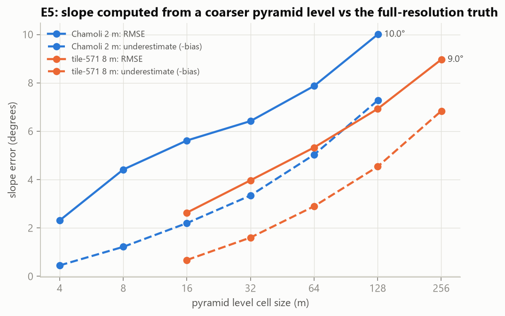
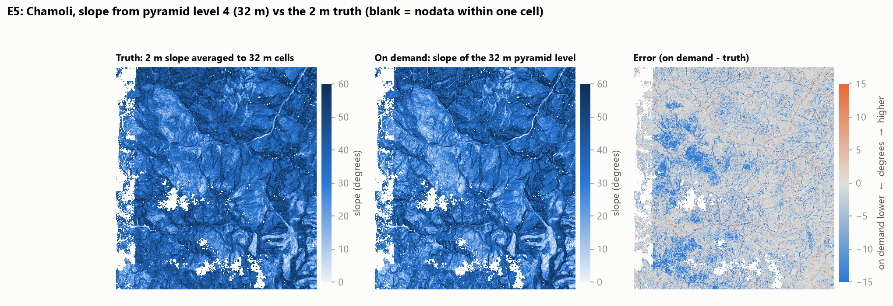
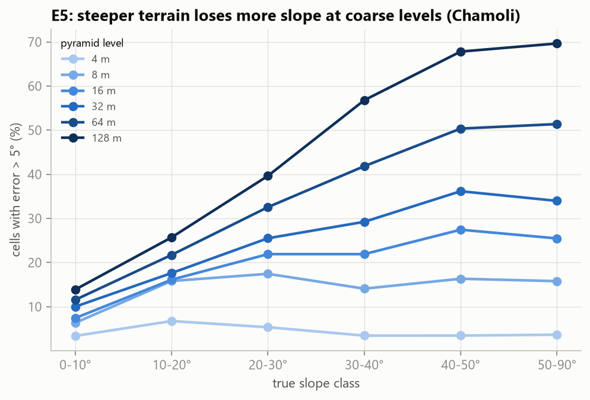
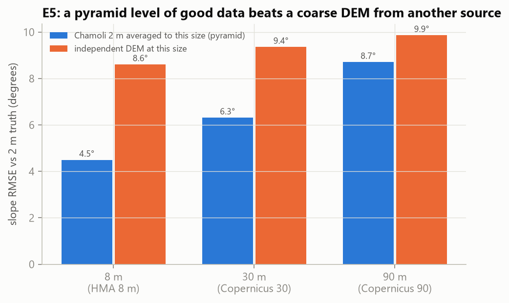
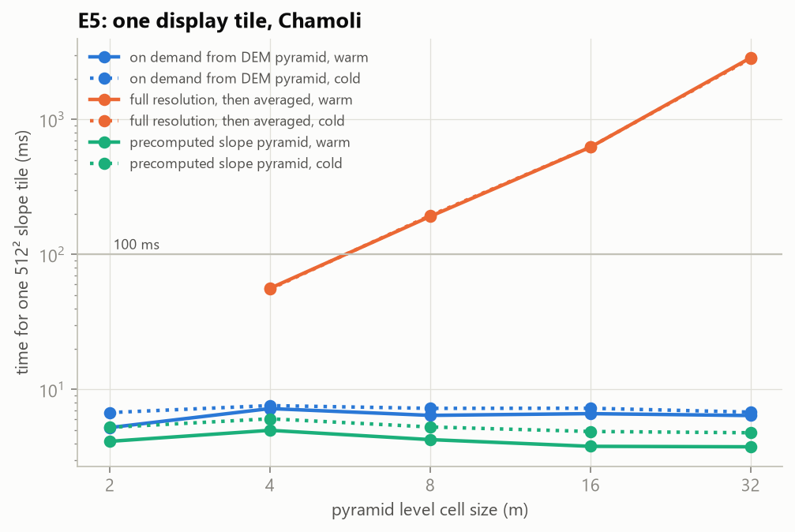
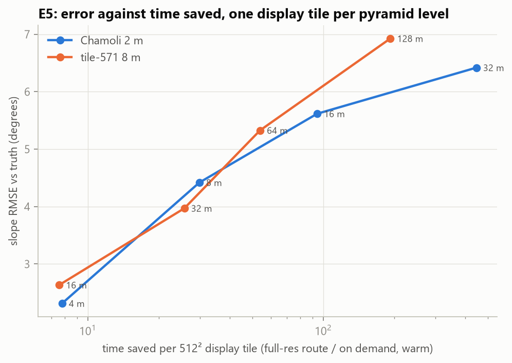

# Phase 4 results: terrain derivatives on demand from the pyramid (E5)

This is the headline experiment for research gap **G2**: *no study computes derivatives on demand from pyramid
levels, or measures how wrong a coarse-level slope is against the time it saves.* The meeting notes ask for the
same design: as the user zooms, read only the needed region at the needed resolution from a pyramid, and compute
slope and aspect there.

**The question:** a viewer showing a large area cannot use the full-resolution DEM. It reads a coarser pyramid
level (a COG overview) and computes slope from that. How far is this slope from the slope a full-resolution
computation would show for the same screen cell? And how much time does it save, compared with computing at full
resolution and averaging, or with a slope pyramid built in advance?

Everything here is reproduced by the scripts listed at the end. Numbers come from `results/e5_*.csv`, tables from
`results/e5_tables.md` and charts from `results/plots/e5_*.png`.

## Key findings

1. **On demand, one display tile costs the same at every zoom level.** A 512 × 512 slope tile computed from the DEM
   pyramid takes **6–7 ms**, cold or warm, at every level. The exact alternative (read the same ground area at full
   resolution, compute slope, average it) grows about 4× per level: 56 ms at 4 m, 0.19 s at 8 m, 0.62 s at 16 m,
   **2.9 s at 32 m**. On demand therefore saves **8× (one level up) to 450× (four levels up)** per tile. For the
   whole Chamoli area at 32 m it takes 13 ms, against 4.7 s.
2. **The price is slope that is too low, and more so the coarser the level.** On the 2 m Chamoli data the RMSE
   against the truth is 2.3° at 4 m, 4.4° at 8 m, 5.6° at 16 m, 6.4° at 32 m, 7.9° at 64 m and 10.0° at 128 m.
   The error is almost all an underestimate: the bias goes from −0.5° to −7.3°, and the mean slope shown drops
   from 99% to 81% of the true mean. The share of cells off by more than 5° rises from 4% to 58%. Averaging the
   DEM smooths the terrain before slope is computed, and that removes steepness.
3. **What matters is how many levels up you go, not the cell size in metres.** The 2 m and 8 m datasets give
   nearly the same error for the same number of levels up: one level 2.3° / 2.6°, two 4.4° / 4.0°, three 5.6° /
   5.3°, four 6.4° / 6.9°, five 7.9° / 9.0°. A useful rule of thumb: **about 2.5° RMSE one level up, then roughly
   1.5° more for each further level**.
4. **Steep terrain loses the most, and slope thresholds shift.** At 32 m (Chamoli) the bias is −0.9° on 0–10°
   ground but −4.0° on 40–50° ground, and 36% of the 40–50° cells are off by more than 5°. The share of terrain
   at or above 45° drops from 29.3% (truth) to 21.9% at 32 m, and from 27.4% to 10.1% at 128 m. A hazard or
   suitability map thresholded on a coarse level would miss much of the steepest ground.
5. **Aspect survives coarse levels much better than slope.** The median direction error is 1.8° at 4 m, 6.3° at
   32 m and 8.5° at 128 m. Only 1.4% (4 m) to 13.7% (128 m) of cells are off by more than 22.5°, the width of
   one 16-point compass sector.
6. **A pyramid level of good data beats a coarse DEM from another source.** Over Chamoli, the 2 m data averaged
   to 8 m gives 4.5° slope RMSE against the truth; the independent HMA 8 m DEM gives 8.6°. At 30 m it is 6.3° vs
   9.4° for Copernicus 30 m, and at 90 m 8.7° vs 9.9° for Copernicus 90 m. The difference between data sources is
   larger than the pyramid error. When a high-resolution DEM exists, its pyramid is the better coarse product.
7. **A precomputed slope pyramid is exact and fastest per tile (4–5 ms), but it costs a full pass and storage for
   every derivative.** For Chamoli: 10.6 s to build (1.6 s slope + 9.0 s compression and overviews) and **958 MB,
   1.5× the DEM pyramid itself**. For the 10 gdaldem configurations that would be about 10 GB, rebuilt whenever a
   parameter changes (sun angle, z-factor, method).
8. **GDAL's overviews work as a pyramid even when the grid size is not a power of two.** Our grids are not
   divisible by every 2^k, so GDAL's overview cells are slightly larger than 2^k fine cells (8.002 instead of 8).
   The overviews still give the same slope error as an exact power-of-two pyramid, within 0.2° RMSE (mostly
   within 0.1°).

**In one sentence:** computing derivatives on demand from the pyramid makes every view cost the same few
milliseconds whatever the zoom. That is 8–450× cheaper than computing at full resolution, and needs none of the
storage of precomputed products. The cost is a systematic underestimate of slope: about 2.5° RMSE one level up,
growing by roughly 1.5° per further level, worst on the steepest ground.

## How it was measured

### Data and levels
- **Chamoli 2 m** (real, 2015 composite, 15120 × 17460 cells, 94% valid): pyramid levels 1–6 = **4, 8, 16, 32, 64,
  128 m**. This is the main result: the finest real data we have in the study area.
- **Tile-571 8 m** (real HMA DEM, 13140 × 12825 cells): levels 1–5 = **16, 32, 64, 128, 256 m**. A second, larger area
  with different terrain, but its truth is itself only 8 m.
- The pyramid is each COG's own overviews (GDAL, AVERAGE resampling), i.e. exactly what a viewer reads. Synthetic
  (upsampled) grids are not used, because they contain no real detail (`docs/PROJECT_PLAN.md` §3.6).

### Truth and error
- **On demand:** slope (Horn) and aspect computed by our engine's kernel on the overview DEM, with the overview's
  own cell size.
- **Truth:** slope and aspect computed at full resolution, then averaged over exactly the fine cells each overview
  cell covers. This is what a screen pixel of that size *should* show: the average steepness of the ground under
  it. Slope uses the plain mean; aspect uses the circular mean of the fine directions.
- **Scored cells:** only "fully valid" ones, where the overview cell and its 8 neighbours cover no nodata at full
  resolution. This keeps data gaps out of the comparison (risk register in the plan). Aspect is scored only where
  the truth slope is ≥ 5° and the fine directions agree (mean resultant length ≥ 0.5). Elsewhere a block has no
  single direction to compare with; this keeps 87–99% of the scored slope cells.
- **Overview geometry:** GDAL halves each level's size and rounds down, so a level cell covers 8.002 fine rows
  rather than 8 when the size is not divisible. Each cell's footprint is therefore taken from its geometry (fine
  cells whose centres fall inside it), using `demlab/pyramid.py`.
- **Cross-check, exact pyramid:** the same analysis on an exact power-of-two pyramid (blocks of 2^k × 2^k fine
  cells averaged by us), where truth and coarse cells cover identical ground.

### Timing
- Three ways to serve a view at level k:
  - **On demand:** read the view from the DEM pyramid level (+1-cell halo) and compute slope.
  - **Full resolution:** read the same ground at full resolution, compute slope, average to level k. This is the
    exact answer without precomputation.
  - **Precomputed:** read the view from a slope pyramid built in advance.
- **Views:** one 512 × 512-cell display tile at 8 random places per level (each ≥ 90% valid), and the whole grid
  at each level.
- **Protocol:** measured inside one long-running process, as a tile server would be, pinned to the 12
  performance-core threads, with GDAL decoding on all threads for every route.
  - *Cold:* the Windows file cache is emptied before each measurement.
  - *Warm:* the median of 3, with the file already in the OS cache.
  - A fresh dataset handle is opened (not timed) for every measurement, so GDAL's own block cache never hides the
    decoding.

## Slope error per pyramid level



| Data | Level | Cell size | RMSE | Bias | % cells off > 5° | % off > 10° | Mean shown / true mean | RMSE, exact pyramid |
|---|---|---|---|---|---|---|---|---|
| Chamoli 2 m | 1 | 4 m | **2.3°** | −0.5° | 4.1% | 0.7% | 0.99 | 2.3° |
| Chamoli 2 m | 2 | 8 m | **4.4°** | −1.2° | 15.5% | 4.1% | 0.97 | 4.4° |
| Chamoli 2 m | 3 | 16 m | **5.6°** | −2.2° | 23.4% | 7.2% | 0.94 | 5.6° |
| Chamoli 2 m | 4 | 32 m | **6.4°** | −3.3° | 30.5% | 10.3% | 0.91 | 6.4° |
| Chamoli 2 m | 5 | 64 m | **7.9°** | −5.0° | 43.1% | 17.1% | 0.87 | 7.8° |
| Chamoli 2 m | 6 | 128 m | **10.0°** | −7.3° | 57.8% | 28.2% | 0.81 | 9.9° |
| Tile-571 8 m | 1 | 16 m | **2.6°** | −0.7° | 6.6% | 0.9% | 0.98 | 2.5° |
| Tile-571 8 m | 2 | 32 m | **4.0°** | −1.6° | 15.6% | 3.0% | 0.95 | 3.9° |
| Tile-571 8 m | 3 | 64 m | **5.3°** | −2.9° | 26.3% | 6.9% | 0.90 | 5.3° |
| Tile-571 8 m | 4 | 128 m | **6.9°** | −4.5° | 40.5% | 13.3% | 0.83 | 6.9° |
| Tile-571 8 m | 5 | 256 m | **9.0°** | −6.8° | 58.7% | 24.9% | 0.73 | 8.8° |

The mean true slope on Chamoli is 38–39°: this is steep Himalayan terrain. Cells scored: 61 M at 4 m down to 51 k at
128 m (Chamoli); 30 M down to 29 k (tile-571), see `results/e5_tables.md`.

**What the map looks like** (Chamoli at 32 m; white = within one cell of a data gap):



The on-demand map keeps every valley, ridge and landslide scar of the truth, but it is lighter (lower slope)
almost everywhere. The error map is mostly blue (on demand lower), strongest on rough, broken slopes and narrow
ridges. Those are the features that averaging the DEM smooths away. The thin orange lines are valley floors,
where averaging blends in the steep valley walls, so on demand reads slightly steeper there.

## Which terrain loses the most



Bias by true slope class (Chamoli; tile-571 is in `results/e5_tables.md`):

| Level | 0–10° | 10–20° | 20–30° | 30–40° | 40–50° | 50–90° |
|---|---|---|---|---|---|---|
| 4 m | −0.1° | −0.2° | −0.3° | −0.3° | −0.6° | −0.8° |
| 8 m | −0.0° | −0.2° | −0.7° | −1.0° | −1.6° | −2.0° |
| 16 m | −0.5° | −0.8° | −1.4° | −2.0° | −2.8° | −3.0° |
| 32 m | −0.9° | −1.5° | −2.6° | −3.3° | −4.0° | −3.9° |
| 64 m | −0.7° | −1.9° | −3.5° | −5.1° | −6.0° | −5.9° |
| 128 m | −0.8° | −2.4° | −4.3° | −7.3° | −8.9° | −8.9° |

Steep cells are also off by more than 5° much more often: at 32 m, 10% of the 0–10° cells but 36% of the 40–50°
cells; at 128 m, 14% vs 68%.

**Slope thresholds.** Many uses of slope are a threshold, for example landslide susceptibility or "too steep to
build". The share of cells on the steep side:

| Level (Chamoli) | ≥ 30°: truth | ≥ 30°: on demand | Same side of 30° | ≥ 45°: truth | ≥ 45°: on demand | Same side of 45° |
|---|---|---|---|---|---|---|
| 4 m | 72.7% | 72.1% | 97.0% | 33.2% | 32.1% | 96.9% |
| 8 m | 73.4% | 71.0% | 93.4% | 32.3% | 29.2% | 93.3% |
| 16 m | 75.0% | 69.2% | 90.5% | 30.8% | 25.7% | 90.9% |
| 32 m | 76.8% | 66.6% | 87.5% | 29.3% | 21.9% | 89.3% |
| 64 m | 78.2% | 62.0% | 82.2% | 28.4% | 16.5% | 86.0% |
| 128 m | 79.4% | 54.6% | 74.1% | 27.4% | **10.1%** | 81.7% |

One level up, a threshold map is still 97% the same. Four levels up, a quarter of the ≥ 45° terrain has
disappeared. For display this is acceptable; for analysis that uses thresholds it is not.

## Aspect

| Level (Chamoli) | Median error | Mean error | 95th percentile | % off > 22.5° | % off > 45° |
|---|---|---|---|---|---|
| 4 m | 1.8° | 3.4° | 11.3° | 1.4% | 0.3% |
| 8 m | 3.8° | 6.9° | 22.8° | 5.1% | 1.2% |
| 16 m | 5.4° | 8.5° | 26.5° | 7.2% | 1.2% |
| 32 m | 6.3° | 9.0° | 26.2° | 7.5% | 0.8% |
| 64 m | 7.6° | 10.4° | 29.5° | 10.3% | 1.2% |
| 128 m | 8.5° | 11.7° | 33.3° | 13.7% | 1.8% |

The direction a slope faces is set by large landforms, so it survives smoothing. Its error grows slowly and stays
below one 16-point compass sector (22.5°) for 86–99% of cells. The 8 m tile gives the same picture (median
2.8° at 16 m to 9.9° at 256 m).

## Pyramid error vs differences between data sources



Over the Chamoli footprint, against the same truth (2 m slope averaged to each size), on the same fully valid cells:

| Size | 2 m data averaged to this size (a pyramid level) | Independent DEM at this size | Independent DEM vs averaged 2 m (elevation: median diff., NMAD) |
|---|---|---|---|
| 8 m | **4.5°** RMSE, bias −1.3° | HMA 8 m: 8.6°, bias −1.7° | 7.3° slope RMSE; elevation +0.6 m, NMAD 4.9 m |
| 30 m | **6.3°**, bias −3.2° | Copernicus 30 m: 9.4°, bias −4.8° | 6.4°; +26.3 m (datum), NMAD 8.0 m |
| 90 m | **8.7°**, bias −5.9° | Copernicus 90 m: 9.9°, bias −6.8° | 3.3°; +26.8 m (datum), NMAD 9.3 m |

At every size, the pyramid of the 2 m data is closer to the truth than a DEM measured natively at that size by
another sensor. The other sensors differ in date (HMA 2017, Copernicus 2011–2015, Chamoli 2015), method and
co-registration, and those differences are larger than what the pyramid loses. The constant ~26 m elevation
offset of Copernicus is the known ellipsoid / geoid datum difference (plan §3.4); a constant offset does not
change slope.

## Time per view



One 512 × 512 display tile (median of 8 places; ms):

| Data | Level | Cell size | On demand, warm / cold | Full res + average, warm / cold | Precomputed, warm / cold | Time saved by on demand |
|---|---|---|---|---|---|---|
| Chamoli | 0 | 2 m | 5.2 / 6.7 | (same as on demand) | 4.1 / 5.2 | – |
| Chamoli | 1 | 4 m | 7.2 / 7.6 | 56 / 55 | 5.0 / 6.1 | **7.8×** |
| Chamoli | 2 | 8 m | 6.4 / 7.3 | 192 / 194 | 4.3 / 5.3 | **30×** |
| Chamoli | 3 | 16 m | 6.6 / 7.3 | 624 / 626 | 3.8 / 4.9 | **94×** |
| Chamoli | 4 | 32 m | 6.4 / 6.8 | 2867 / 2823 | 3.8 / 4.8 | **447×** |
| Tile-571 | 1 | 16 m | 6.9 / 7.1 | 52 / 57 | 4.2 / 5.3 | 7.6× |
| Tile-571 | 2 | 32 m | 7.2 / 7.5 | 186 / 192 | 4.5 / 6.2 | 26× |
| Tile-571 | 3 | 64 m | 7.1 / 7.6 | 380 / 400 | 4.1 / 5.3 | 54× |
| Tile-571 | 4 | 128 m | 6.2 / 7.0 | 1186 / 1204 | 3.2 / 4.1 | 193× |

Whole grid at each level (s, warm):

| Data | Level | On demand | Full res + average | Precomputed |
|---|---|---|---|---|
| Chamoli | 0 (2 m) | 1.58 | – | 0.41 |
| Chamoli | 2 (8 m) | 0.19 | 6.0 | 0.09 |
| Chamoli | 4 (32 m) | 0.013 | 4.7 | 0.005 |
| Chamoli | 6 (128 m) | 0.001 | 4.4 | 0.001 |
| Tile-571 | 0 (8 m) | 0.95 | – | 0.25 |
| Tile-571 | 3 (64 m) | 0.034 | 3.2 | 0.014 |

- **On demand is flat** because a 512² tile is always 514² cells read plus under 1 ms of kernel, whatever the
  level. The full-resolution route reads 4× more ground per level.
- **Cold vs warm hardly matters** (at most 1–2 ms per tile) on this NVMe SSD. A tile touches only a few compressed
  512² blocks.
- **Precomputed is 2–3 ms faster per tile** (no computation), the same order as on demand. Both are far below the
  ~100 ms at which a pan or zoom starts to feel slow.

## Error against time saved (the G2 trade-off)



| Level up from the data | Time saved per tile | Slope RMSE | Bias | % off > 5° | Aspect median error |
|---|---|---|---|---|---|
| 1 (Chamoli 4 m) | 7.8× | 2.3° | −0.5° | 4% | 1.8° |
| 2 (8 m) | 30× | 4.4° | −1.2° | 16% | 3.8° |
| 3 (16 m) | 94× | 5.6° | −2.2° | 23% | 5.4° |
| 4 (32 m) | 447× | 6.4° | −3.3° | 30% | 6.3° |

Each level up saves roughly 4× more time (4× fewer cells) and costs roughly 1.5–2° more slope RMSE.

## What a precomputed slope pyramid costs

| Data | Full-res slope | Compress + build overviews | Total, once | Slope pyramid size | DEM pyramid size |
|---|---|---|---|---|---|
| Chamoli 2 m | 1.6 s | 9.0 s | **10.6 s** | **958 MB** | 620 MB |
| Tile-571 8 m | 1.0 s | 5.9 s | **7.0 s** | **561 MB** | 422 MB |

Slope compresses worse than elevation (it is rougher), so one derivative pyramid is larger than the DEM pyramid
itself. This is per derivative and per parameter set: slope Horn, slope ZT, aspect, a hillshade per sun position,
TRI, TPI and roughness would together need about 10× this, and would have to be rebuilt whenever the DEM is
updated. On demand needs none of it.

## Check: GDAL's overviews vs an exact pyramid

| Level (Chamoli) | Fine cells per overview cell (rows × cols) | Overview elevation vs mean of its fine cells | Slope RMSE: COG overview / exact pyramid |
|---|---|---|---|
| 1, 2 | 2.000 × 2.000, 4.000 × 4.000 | identical (< 0.0005 m) | 2.31 / 2.31°, 4.42 / 4.42° |
| 3 | 8.002 × 8.000 | RMSE 0.48 m | 5.62 / 5.56° |
| 4 | 16.004 × 16.000 | RMSE 0.40 m | 6.42 / 6.41° |
| 5 | 32.037 × 32.034 | RMSE 1.46 m | 7.87 / 7.76° |
| 6 | 64.19 × 64.07 | RMSE 2.17 m | 10.00 / 9.90° |

Where the grid size divides exactly, GDAL's AVERAGE overview is exactly the block mean. Where it does not, the
overview cell is slightly larger than 2^k fine cells. GDAL then also weights the partly covered fine cells at its
edges (a one-off test, `old files/scripts_one_off_checks/overview_footprint.py`: GDAL matches the
"centres inside" footprint best, but not exactly). So its values differ from our whole-cell footprint mean by a
few decimetres to metres. The effect on slope error is at most 0.2° RMSE. For the same reason, the precomputed
slope pyramid scores 0.3–1.0° RMSE instead of 0 at those levels: that is our footprint approximation, not slope
error. A tile server can use COG overviews as they are. Padding grids to a multiple of 2^k would make them exact,
but it is not needed.

## Limitations

- **One region, steep terrain.** The mean true slope is 38° on Chamoli and 31° on tile-571. Flatter regions would
  show smaller errors, and the slope-class tables give the error per class to carry over.
- **The truth is itself a DEM.** The 2 m composite has its own noise, and part of what the coarse levels "lose" is
  2 m noise. Slope at 2 m is rougher than the ground may really be. The tile-571 truth is only 8 m.
- **Coverage at coarse levels.** The fully-valid rule drops more cells at coarse levels (tile-571 256 m: 17% of
  cells scored). Those are cells near the data gaps, which on tile-571 lie in the steepest parts. That is why its
  mean true slope falls from 31° to 26° across levels.
- **Aspect truth is a choice.** The circular mean of fine directions, scored only where they agree; the
  alternatives (the direction of the mean gradient, weighting by slope) would give slightly different numbers.
- **Timing is on one machine.** NVMe SSD, files in a local folder, one process. A network COG (HTTP range
  requests) would add latency per request and make the gap between the routes larger.

## What it means

- **For G2:** answered with numbers. Each pyramid level up saves about 4× in time per view (8–450× per tile for 1–4
  levels) and costs about 1.5–2.5° slope RMSE, as a systematic underestimate that is largest on steep ground. Aspect
  costs much less (median 2–8°).
- **For Phase 5 (tile server, E6):**
  - Pick the pyramid level so that one level cell ≈ one screen pixel. Then the on-demand value is close to what
    that pixel should show, and every tile costs ~7 ms (under 1 ms of it computing).
  - Precompute only the one or two most-used products (slope), if storage allows; compute everything else on
    demand (other operators, any hillshade sun angle).
  - Add a tile cache: re-reading the same compressed blocks for every view is the main cost, not the kernel
    (E3 / E4).
- **For analysis rather than display:** never threshold slope computed from a coarse level. Compute the view at full
  resolution (the full-resolution route: 0.06–3 s per tile here), or read a precomputed slope pyramid.
- **Possible improvement (not done):** the underestimate is systematic (mean slope shown = 0.99 … 0.81 × true
  mean), so a per-level correction factor could remove most of the bias, but not the spread.

## Reproduce

```
python -m bench.experiments.e5_timing --precompute   # slope pyramids (D:\geoguessers_data\bench_out\e5_slope_*.tif)
python -m bench.experiments.e5_accuracy              # error tables + map figure (~5 min)
powershell -ExecutionPolicy Bypass -File bench\run_e5.ps1   # timing (~30 min, log logs\e5_timing_log.txt)
python -m bench.analysis.e5_report                   # results/e5_tables.md + charts
python -m pytest tests/test_pyramid.py -q            # footprint / block-sum helpers
```
Code: `demlab/pyramid.py` (overview access, footprints, block sums), `bench/experiments/e5_accuracy.py`,
`bench/experiments/e5_timing.py`, `bench/analysis/e5_report.py`.
