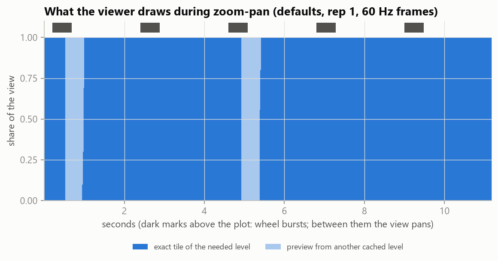
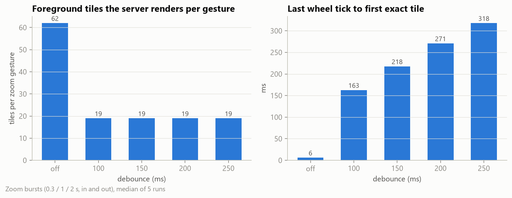
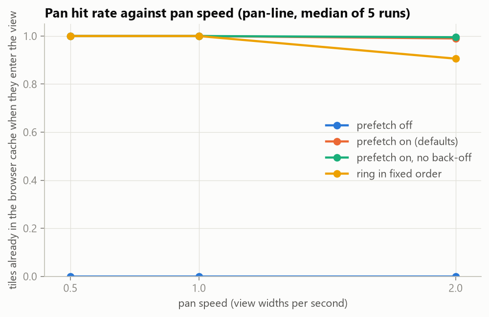
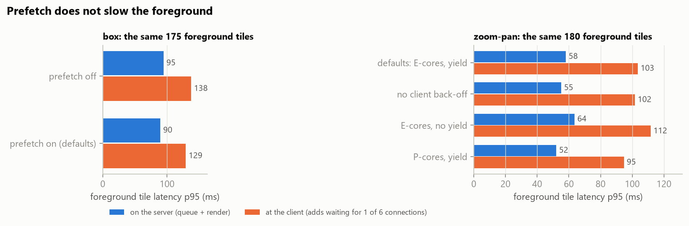
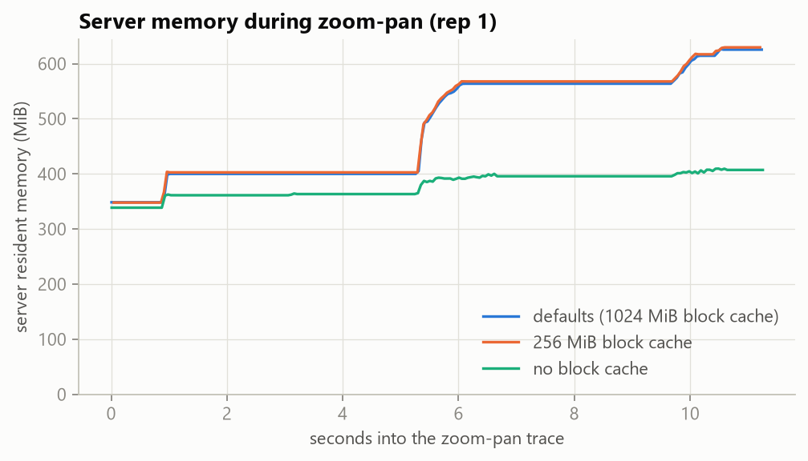

# Phase 5 results: interactive viewing with debounced pan / zoom and prefetch (E6)

This phase turns the earlier findings into a working viewer and measures it. E1–E4 showed that full-resolution
processing is bound by decoding and memory, not arithmetic. E5 showed that computing a derivative on demand from a
pyramid level costs the same few milliseconds at every zoom level, with a known slope error. The professor asked
for the viewer to work like a map: pan and zoom continuously, compute only what is in view, and prefetch the
neighbourhood. The goals come from Kartikeya's spec (`docs/PHASE5_DEBOUNCED_ZOOM_SPEC.md`); the working plan is
`docs/FINAL_PLAN.md` (Phases 1–5 there).

**The questions:**
1. Can on-the-fly computation keep up with continuous pan and zoom on one laptop?
2. Does a trailing debounce on zoom cut the work the server does, and what does it cost in delay?
3. Does prefetching the neighbouring views make panning seamless without slowing what the user is looking at?
4. Which settings (debounce, prefetch policy, worker pools, core placement, cache sizes) should be the defaults?

Numbers come from `results/runs.csv` (experiment E6), `results/e6_requests.csv`, `e6_gestures.csv`,
`e6_frames.csv`, `e6_memory.csv` and `e6_browser.csv`. Tables are in `results/e6_tables.md` and charts in
`results/plots/e6_*.png`. Sizes: MB = 10^6 bytes, MiB = 2^20 bytes.

## What was built

| Part | Where | What it does |
|---|---|---|
| Tile engine | `demlab/view.py`, `kernels/tile_k.py`, `blockcache.py`, `resultcache.py`, `colormap.py` | Fixed 512 × 512 tile lattice per pyramid level, aligned to the COG blocks. One tile is rendered on one thread with GIL-free kernels. Decoded blocks are shared in a byte-budgeted cache, so a tile's 1-cell halo does not re-decode up to 8 neighbouring blocks. Encoded tiles go in a second cache. Output is 8-bit palette PNGs. Modes: `auto` (the level's own cells), `exact` (full resolution, averaged), `precomputed` (stored slope pyramid). |
| Scheduler | `demlab/sched.py`, `cpus.py` | Two queues: foreground (visible) and background (prefetch). Foreground workers are pinned to the 12 performance-core threads and background workers to the 8 efficiency cores. Identical requests share one job. A foreground request promotes a queued prefetch job. A newer generation supersedes older work. Cancellation is checked between stages. Prefetch does not start while foreground work is pending, and pauses when free memory runs low. |
| Server | `server/app.py` (`python -m server`) | FastAPI. Tiles, overview, `POST /view` (a box as PNG or GeoTIFF), session generations, prefetch, stats. Every tile carries `Server-Timing` (queue, read, decode, kernel, colour map, encode) and its cache tier. A closed connection cancels the job. |
| Web viewer | `viz/web/` (open http://127.0.0.1:8765/viewer/) | Plain ES modules. Each frame draws the needed level's tiles, falling back to a coarser or finer cached level and then the overview. Zoom commits once after a trailing debounce; pan requests new tiles at once. Requests carry generations and are aborted when no longer visible. After a commit, the 8 neighbouring views are prefetched (velocity-first, at most 2 in flight). Shift + drag zooms to a box. Policy in `viz/web/policy.json`. |
| QGIS plugin | `qgis_plugin/` | Drag a box in QGIS; the server's `/view` result is added as a styled GeoTIFF layer in UTM 44N. |
| E6 bench | `bench/vclient.py`, `bench/traces/`, `bench/experiments/e6_view.py`, `bench/e6_browser.py`, `bench/analysis/e6_report.py` | A Python port of the viewer's policy replays seeded traces against a fresh server per run. Headless Chrome replays three of the traces as a cross-check. |

Gates passed while building it (details in `docs/FINAL_PLAN.md`):
- **Tile kernels:** 5.4× on 8 threads.
- **Prefetch isolation:** foreground p95 is within 0.4% of an idle server with 256 prefetch tiles queued.
- **Cancellation:** an aborted request is dropped in a median 37 ms.
- **Web viewer:** passes all four in-browser checks (`python -m bench.check_viewer`).
- **QGIS plugin:** a full-resolution box is identical to gdaldem's slope of the full-resolution DEM.

## Key findings

1. **Yes, on-the-fly computation keeps up with continuous viewing.**
   - **Pans:** with the default policy, 98–100% of the tiles entering the view are already in the browser when they
     appear, at 0.5, 1 and 2 view widths per second, straight or reversing. Blank area-time rounds to 0.000: the needed
     level's own tiles cover the view in practically every pan frame.
   - **Zoom bursts:** the first exact tile appears 57–89 ms after the commit, and the whole view 76–158 ms after
     it.
   - **Box zoom:** the first exact tile appears 64 ms after the animation ends, and the whole view after 127 ms.
   - **Cost:** the server never needed more than 982 MiB, and prefetch used about 3 CPU-seconds of efficiency
     cores per 5 s pan.
2. **The debounce cuts server work by 3.3× and passes the gate.**
   - **Work:** over the six 60 Hz zoom bursts, committing on every wheel tick made the server render a median of
     62 foreground tiles per gesture (up to 121 commits per burst, 4–19 tiles cancelled mid-render). With a
     trailing debounce it renders 19.
   - **Delay:** the first exact tile arrives 63–71 ms after the debounce fires, well inside the spec's 100 ms.
   - **What it trades:** a fixed wait after the last tick (the debounce itself) against wasted work and a
     contended commit.
3. **150 ms is the right debounce, not 100 or 200.**
   - **Why the bursts can't choose:** with steady 60 Hz ticks every value from 100 to 250 ms gives the same 19
     tiles, because the gaps are only 17 ms.
   - **A notched mouse wheel decides it.** Its ticks come 30–300 ms apart. With 10 notches 30–150 ms apart:
     - 100 ms commits between notches: 36 tiles per gesture, the same as no debounce;
     - 150, 200 and 250 ms all coalesce the gesture: 15 tiles.
   - **Slow scrolling** (gaps 120–300 ms): 100 ms gives 48 tiles; 150 ms and longer give 39.
   - **Cost of going longer:** 200 ms costs 40–50 ms more delay than 150 ms for no fewer tiles.
   - The default is now **150 ms**. A forced commit after 500 ms of continuous scrolling (`maxWaitMs`) almost
     doubles the tiles (35 vs 19) for 9 ms less delay, so it stays off.
4. **Prefetch makes panning seamless.**
   - **With prefetch:** pans need 0–5 foreground requests instead of 36–202. On a straight pan the tiles
     entering the view are 99–100% cached.
   - **Without it:** 0% are cached on a straight pan, and about 50% on a pan that turns back over its own path.
   - **Cost:** precision is 0.20–0.56, so 2–5 tiles are fetched for each one used. A ring of 8 neighbours
     always loads directions the user does not take.
   - **Ordering:** velocity-first (the direction of travel first) keeps the hit rate at 0.99 at 2 view widths per
     second. A fixed order drops it to 0.91.
5. **Prefetch does not slow the foreground (gate 1 passes).**
   - **Like for like:** on the box trace the foreground tiles are identical with prefetch on and off. Server p95
     is 90 ms with prefetch vs 95 ms without, and client p95 129 vs 138 ms. Prefetch is slightly *faster*,
     because it has already decoded shared blocks.
   - **The reason is structural.** Prefetch stops at the first input event of a gesture and restarts only when the
     view is complete. With the defaults, only 25 of 905 foreground tiles (3%) were ever requested while a
     prefetch request was in flight.
   - **Isolation check:** the Phase 2 test, with identical foreground work and a saturated prefetch queue, gave
     +0.4%.
   - **Placement:** on the zoom-pan trace, letting prefetch start while foreground work is pending raises server
     p95 by 9% (64 vs 58 ms).
   - **Pinning verified:** across all runs, 20,242 foreground jobs ran on performance cores only and 122,215
     prefetch jobs on efficiency cores only.
6. **The client's latency back-off must not sit near the cold-start latency.** The first policy backed prefetch
   off for 2 s whenever the last 20 foreground tiles had p95 above 100 ms. Right after a cold start that p95 is
   about 100 ms: decoding a fresh view's blocks while 15–20 tiles queue on the browser's 6 connections. Results:
   - prefetch switched off at random (pilot);
   - in the sweep, the fast reversing pan fell from a 0.98 to a 0.50 hit rate (19 back-offs per run);
   - at 250 ms (the new default) behaviour equals "no back-off" on every trace, and the safety valve stays for a
     truly overloaded server.
7. **The browser's 6 connections, not the server, set the foreground latency.**
   - **Connection wait:** client latency is about 40 ms above server latency at p95 (box: 90 → 129 ms), because
     tiles queue for a connection.
   - **Workers:** 4, 6 or 8 foreground workers give the same client p95 (101–106 ms on the mixed traces). With 4,
     the server-side p95 is even lower (76 vs 98 ms; less contention for decoding), but one browser cannot use
     more than 6 at a time. The default stays 8 so a second client (QGIS, another tab) does not queue.
8. **Caches:**
   - **Block cache:** without it, the server decodes 6× more blocks (1,128 vs 185 per mixed run) and foreground
     p95 rises 40% (146 vs 104 ms).
   - **Size:** 256 MiB gives the same as 1,024 MiB over these 1–11 s traces, because the cache never fills.
   - **Result cache:** switching it off changes nothing here. Each run uses a fresh server and the browser keeps
     its own tiles, so a tile is never asked for twice. It matters across sessions and clients, which E6 does not
     exercise.
9. **Product, mode and data hardly matter; the OS cache doesn't either.**
   - **Products:** slope and aspect tiles are about 10% slower than hillshade.
   - **Precomputed slope tiles** are the fastest on the server (p95 56 vs 98 ms): one block, no halo, no kernel.
   - **The 8 m dataset** behaves like the 2 m one.
   - **Cold vs warm:** a flushed OS file cache gives the same numbers as a warm one, because decoding, not disk,
     is the cost (consistent with E1–E3).
10. **The virtual client agrees with a real browser.** In headless Chrome over the DevTools protocol, the same
    traces gave:
    - the same commits, foreground requests (15, 0, 35) and prefetched tiles (120 vs 120; 306–310 vs 308–313);
    - view-complete times within 10% (298 vs 325 ms; 123 vs 127 ms);
    - first frames 18–25 ms sooner in Chrome (248 vs 273 ms; 46 vs 64 ms).

    The Python client is slightly conservative, so the E6 latencies are upper bounds.

**In one sentence:** computing derivatives on demand keeps up with continuous pan and zoom on one laptop:
- **Panning:** a velocity-first ring of neighbouring views makes it seamless, at no cost to the foreground,
  because prefetch never runs while the user is waiting.
- **Zooming:** a 150 ms trailing debounce cuts the server's work per zoom gesture 3×.
- **Latency:** set by the browser's connection limit and block decoding, not by computing the derivatives.

## How it was measured

**Driver.** `bench/vclient.py` ports `viz/web/js` to Python: camera, level choice with hysteresis, byte-budgeted
bitmap cache, trailing debounce, generations, aborts, prefetch ring and back-off. It reads the same
`viz/web/policy.json` as the browser and replays a trace in real time against the live server:
- HTTP/1.1 through `httpx`, at most 6 connections;
- 60 Hz frames;
- aborting a request closes its connection, as `AbortController` does in a browser.

Python 3.12's event-loop clock on Windows has 15.6 ms steps and runs timers up to one step early. The client
therefore uses its own loop on the high-resolution clock (timers accurate to about 1 ms). A first attempt without
this was stopped and rerun; see Problems.

**Traces** (`bench/traces/*.json`, seeded, regenerated by `python -m bench.traces.make_traces`), for a 1600 × 900
view:

| Family | Traces |
|---|---|
| `pan-line` | 5 s at 0.5, 1 and 2 view widths per second, roughly diagonal, at level 0 |
| `pan-reverse` | The same, turning back at 2.5 s |
| `pan-walk` | 6 s random walk, new heading every 0.3–1 s |
| `zoom-burst` | 60 Hz wheel ticks for 0.3 / 1 / 2 s, in and out, 1 / 2 / 3 levels |
| `zoom-notched` | 10 discrete notches, 30–150 ms apart (brisk) or 120–300 ms apart (slow), 2 levels in |
| `zoom-pan` | 10 s of alternating 0.5 s bursts (one level) and 1 s pans |
| `box` | Three nested box zooms (×4 each) from the whole map to full resolution |

**Protocol.** One factor at a time around the defaults, 24 configurations (`configs()` in
`bench/experiments/e6_view.py`). Every (configuration, trace) gets 1 warm-up and 5 measured runs: 996 runs
(147 min), plus 72 for the notched traces. Each run:
1. starts a new server process (empty caches; kernels warmed on the other dataset);
2. loads the overview and the first view with its prefetch ring;
3. starts the trace clock.

Server counters are read from `/stats` at the trace start and end. RSS and free memory are sampled every 50 ms,
and per-CPU times bracket the trace. The OS file cache is warm, except in `cold`, which flushes it before each run.
Prefetch's free-memory guard was set to 0.5 GB because the editor leaves this laptop with about 2 GB free. No
prefetch request was refused in any run (free memory never fell below 633 MB).

**Metrics:**

| Metric | Definition |
|---|---|
| Pan hit rate | Share of tiles that are already cached when they first enter the view while panning at a settled level |
| Blank area-time | Share of view area × frames not drawn from the needed level's own tile (a preview or the overview instead) |
| TTFF | Last wheel tick (or the end of the box animation) to the first frame showing a tile of the committed level |
| Complete | Last tick to the first frame in which every visible tile of the needed level is drawn |
| Server tiles per gesture | Foreground jobs the server finished or cancelled mid-render, divided by zoom gestures |
| Prefetch precision | Prefetched tiles later drawn, divided by prefetched tiles |
| Foreground p95 | Over tiles the server rendered: at the client (request to response), and on the server (queue + render, from `Server-Timing`) |

## Defaults on every trace

Median [interquartile range] over 5 runs; debounce 200 ms (the sweep's base), prefetch on, Chamoli 2 m,
hillshade. Full table: `results/e6_tables.md`.

| Trace | Foreground requests | Prefetched | Pan hit rate | TTFF ms | Complete ms | Server fg tiles / gesture |
|---|---|---|---|---|---|---|
| pan-line 0.5 / 1 / 2 | 0 / 0 / 2 | 175 / 313 / 333 | 1.00 / 1.00 / 0.99 | | | |
| pan-reverse 0.5 / 1 / 2 | 0 / 0 / 5 | 73 / 128 / 443 | 1.00 / 1.00 / 0.98 | | | |
| pan-walk | 0 | 290 | 1.00 | | | |
| zoom-burst in 0.3 / 1 / 2 s | 20 / 15 / 20 | | | 272 / 273 / 289 | 325 / 325 / 358 | 20 / 15 / 20 |
| zoom-burst out 0.3 / 1 / 2 s | 18 / 20 / 12 | | | 269 / 264 / 257 | 321 / 314 / 276 | 18 / 20 / 12 |
| zoom-pan | 36 | 128 | 1.00 | 206 | 206 | 7.2 |
| box | 35 | 125 | | 64 | 127 | |

TTFF for the zoom traces includes the 200 ms debounce. In zoom-pan three of the five gestures zoom back out to levels
whose tiles are already cached (no requests), so the median gesture completes as soon as the debounce fires; the
two zoom-ins need 16 and 20 tiles and complete about 300–320 ms after the last tick.



During zoom-pan, the needed level's own tiles cover the whole view except for a few hundred milliseconds after the
two zoom-ins, when coarser cached tiles stand in. During pans the view is always complete.

## Gate 2: debounce



| Debounce | Server fg tiles / gesture, 60 Hz bursts | Notched 30–150 ms | Notched 120–300 ms | TTFF − debounce, bursts (ms) | TTFF, bursts (ms) |
|---|---|---|---|---|---|
| off (every tick) | 62 | 36 | 48 | – | 6 |
| 100 ms | 19 | 36 | 48 | 63 | 163 |
| **150 ms (new default)** | 19 | **15** | **39** | 68 | 218 |
| 200 ms | 19 | 15 | 39 | 71 | 271 |
| 250 ms | 19 | 15 | 39 | 68 | 318 |
| 200 ms + forced commit at 500 ms | 35 | 30 | 39 | 62 | 262 |

Without a debounce, every tick changes the generation, aborts the previous commit's requests, and starts the
next. The server still finishes most of the aborted tiles (they are short) and cancels 4–19 per burst mid-render.
The browser shows a sharp preview the whole time (blank area-time 0.1 vs 0.4 with a debounce), which is the one
thing committing on every tick buys.

## Prefetch



| Configuration (pan traces + zoom-pan, 40 runs) | Foreground requests | Pan hit rate | Prefetched | Precision | Back-offs |
|---|---|---|---|---|---|
| prefetch off | 104 [68–135] | 0.30 [0.00–0.51] | 0 | – | 0 |
| defaults (back-off at p95 > 250 ms) | 0 [0–4] | 1.00 [1.00–1.00] | 218 [128–314] | 0.34 | 0 |
| back-off at p95 > 100 ms (first policy) | 0 [0–56] | 1.00 [0.70–1.00] | 192 | 0.29 | 0 [0–19] |
| no back-off | 0 [0–4] | 1.00 [1.00–1.00] | 232 | 0.34 | 0 |
| ring in fixed order | 0 [0–7] | 1.00 [0.97–1.00] | 292 | 0.33 | 0 |

Without prefetch, the view still looks almost complete: blank area-time is 0.2–3.4% on the pans. Each new tile
arrives in about 50 ms, and the coarser cached level covers the gap. Prefetch removes even that, along with
36–202 foreground requests per pan.

## Gate 1: prefetch and the foreground



| Trace | Configuration | Foreground tiles rendered | Overlapping a prefetch request | Server p95 ms | Client p95 ms |
|---|---|---|---|---|---|
| box (same tiles) | prefetch off | 175 | 0% | 94.7 | 137.6 |
| box (same tiles) | prefetch on | 175 | 0% | 89.7 | 129.3 |
| zoom-pan | prefetch on: E-cores + yield (defaults) | 180 | 0% | 58.1 | 103.5 |
| zoom-pan | E-cores, no yield | 180 | 0% | 63.6 | 111.6 |
| zoom-pan | P-cores (shared) + yield | 180 | 0% | 52.1 | 94.8 |

The spec's form of the gate is foreground p95 per trace with prefetch on vs off. That compares different tiles:
with prefetch on, pans need almost no foreground tiles, and what remains are the cold tiles at a new level after a
zoom. The like-for-like comparison is the box trace, where the foreground tile set is the same, and there prefetch
makes it slightly faster.

## Workers, caches and the rest (mixed traces: pan-walk, zoom-pan, two bursts, box; 25 runs each)

| Configuration | Client fg p95 ms | Server fg p95 ms | Complete ms | Blocks decoded | Peak RSS MiB |
|---|---|---|---|---|---|
| defaults (8 fg workers, 1024 MiB blocks, 512 MiB results) | 104 | 98 | 260 | 185 | 608 |
| 4 foreground workers | 106 | 76 | 254 | 185 | 588 |
| 6 foreground workers | 101 | 92 | 251 | 185 | 598 |
| no block cache | 146 | 111 | 285 | 1,128 | 386 |
| 256 MiB block cache | 108 | 94 | 260 | 185 | 608 |
| result cache off | 103 | 91 | 257 | 185 | 576 |
| slope / aspect instead of hillshade | 115 / 115 | 97 / 103 | 255 / 258 | 185 | 606 / 608 |
| precomputed slope | 93 | 56 | 248 | 160 | 562 |
| tile-571 8 m | 118 | 92 | 268 | 130 | 594 |
| OS file cache flushed | 103 | 104 | 257 | 185 | 608 |



## Policy set from the data

| Setting | Before E6 | Now | Why |
|---|---|---|---|
| `debounceMs` | 200 | **150** | Same tiles as 200 and 250 ms on every trace, including notched wheels; 40–50 ms sooner; 100 ms commits between notches |
| `maxWaitMs` | off | off | A forced commit nearly doubles tiles per gesture for 9 ms |
| `prefetch.backoffP95Ms` | 100 | **250** | 100 ms sits at the cold-start p95 and switches prefetch off at random; 250 ms equals "no back-off" in every trace and keeps a safety valve |
| `prefetch.order` | velocity-first | velocity-first | 0.99 vs 0.91 hit rate at 2 view widths per second |
| `prefetch.maxInFlight` | 2 | 2 | Leaves 4 of the browser's 6 connections for the foreground; hit rate already 0.98–1.00 |
| Server foreground workers | 8 | 8 | 4–8 equal for one browser (6 connections); 8 leaves room for a second client |
| Server background placement | E-cores + yield | E-cores + yield | Verified on every job; not yielding costs 9% foreground p95 |
| Block cache | 1024 MiB | 1024 MiB | 256 MiB is enough for short traces; longer sessions and the QGIS plugin reuse more blocks |

## Problems found and fixed

- **Timer precision.** The first E6 attempt was stopped after 17 runs: the client's debounce could fire up to
  16 ms early (Windows event-loop clock). The partial runs are kept in `old files/results_superseded/` and the
  sweep was rerun with a high-resolution loop.
- **A gate that compares unlike things.** See gate 1: per-trace foreground p95 with prefetch on and off measures
  different tiles. The report adds the like-for-like comparison.
- **Back-off threshold.** See finding 6: found in the pilot and changed before the sweep (the sweep still measures
  the old value).
- **Steady 60 Hz ticks hide the debounce choice.** The notched-wheel traces were added after the main sweep for
  that reason.
- **Headless Chrome's virtual time distorts latencies.** The browser checks (`bench/check_viewer.py`,
  `bench/e6_browser.py`) now drive real-time Chrome over the DevTools protocol, using the `websockets` package
  already installed with the server. No Playwright was needed.

## Limitations

- **One client, one laptop.** The result cache and the spare foreground workers are there for several clients
  (browser + QGIS); E6 runs one.
- **Short synthetic traces.** Traces last 1–11 s and are seeded rather than recorded from people. Caches never
  fill, so long-session behaviour (evictions, the result cache) is not measured.
- **Simulated client.** The virtual client is a port of the viewer, not the browser. The headless-Chrome check
  agrees on all counts and within 10% on view-complete times, but it covers three traces.
- **Cold start only.** Every run starts with an empty server. A warm server (a returning user) answers more tiles
  from its caches, so these latencies are on the slow side.
- **CPU only.** The GPU path (E4) is not used: at 512 × 512 per tile, E4 predicts little gain (1.3× including the copies) once the transfer is
  counted.

## Reproduce

```
conda activate geo
python -m bench.traces.make_traces                        # traces (already committed)
powershell -ExecutionPolicy Bypass -File bench\run_e6.ps1   # E6 sweep, ~2.5 h (log: logs\e6_log.txt)
python -m bench.experiments.e6_view --only base debounce-off debounce-100 debounce-150 debounce-250 maxwait-500 --traces zoom-notched zoom-notched-slow
python -m bench.e6_browser                                # headless Chrome vs virtual client
python -m bench.analysis.e6_report                        # results/e6_tables.md, results/plots/e6_*.png
python -m bench.check_viewer                              # the viewer's in-browser checks
```
